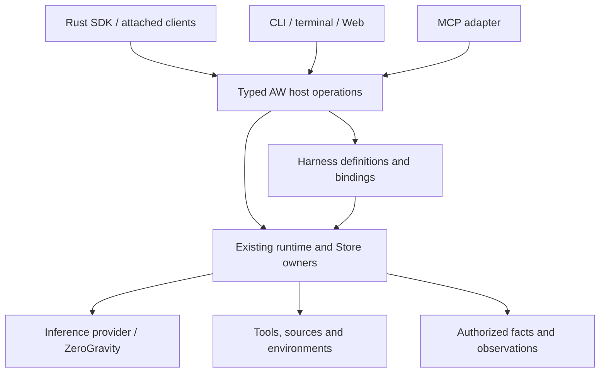

# Design — AW as a live programmable harness

Date: 2026-11-28
Base: `a47492f45813f1e85f85e706e7f33292f0c3e6f0`
Status: accepted direction with detailed implementation planning; no runtime implementation claimed.
Plan: [README](README.md) · [Implementation map](IMPLEMENTATION.md) · [Queue](TODO.md)
Canonical proposed signatures and protocols: [API_AND_PROTOCOLS](API_AND_PROTOCOLS.md).

## 1. Product contract

**AW is a live programmable harness for agents and the environments they work in.**

A harness describes how an agent receives work, constructs context, chooses
models, reasons and acts, delegates, checks results, retains useful state, and
responds to events. Users can start with a useful default, fork it, replace parts,
and change future behavior while work continues under coherent prior revisions.

The SDK is the primary authoring and control contract. CLI, terminal UI, Web,
MCP and external automation expose that same contract. An AI author has the same
typed operations as a developer, within its granted scope.

The implementation retains four Runtime primitives: Runtime, Actor, Message,
Envelope; and two Hook verbs: Next, Defer. Harness definitions are application
composition, not a fifth Runtime primitive.

Implementation follows the [engineering contract](IMPLEMENTATION.md): share Rust
primitives and original owners, keep native calls typed, resolve immutable handles
outside hot paths, and prefer clean efficient code over elaborate abstraction.
Verification follows a small set of meaningful integration scenarios; product
receipts do not imply a new evidence framework.

HP-1–3 establish the whole declared public API and component integration boundary,
plus a usable native/attached/MCP foundation. Later components develop their own
algorithms and product capabilities against those contracts. Their internal
versions, deployment and migration can progress independently; common ownership
and lifecycle semantics are settled before that expansion.

### Layer ownership

| Layer | Owns |
|---|---|
| Products above AW | Product goals, domain rules, business workflows, user experience |
| AW | Agent behavior, context, coordination, tools, Jobs, environments, authority, factual history, evaluation and promotion |
| ZeroGravity or another inference service | Model execution, model programs/revisions, inference pipelines, batching, cache/device/kernel decisions |
| Tool/environment providers, including dotlink | Their concrete resources and execution endpoints, under explicit configured authority |

AW selects an authorized inference target. ZeroGravity executes that inference.
AW schedules agent work; ZeroGravity schedules model execution. Those schedulers
operate at different levels and should not be merged.

AW must remain usable with other inference providers. ZeroGravity must remain
usable without AW. Ordinary integration uses the existing Provider/explicit
inference-executor boundary. Optional richer capability adapters may expose exact
inference revision, continuation and metrics support without requiring a lockstep
release or a hard dependency on ZeroGravity internals.

## 2. What the source already provides

The audit read live source, current handoff, R6 plan and relevant SDK documents.
Historical documents are secondary where source differs.

| Area | Implemented foundation | Gap for this design |
|---|---|---|
| Portable agent engine | aw-agent-kernel TurnMachine; hosted aw-agent-core Agent; intent/receipt ordering | No rewrite required; add only narrowly justified strategy ports |
| Native SDK | AgentBuilder, Provider, Tool, Extension, journals and independent examples | Full product composition remains substantially in root application modules |
| Host composition | aw-host LocalHost; configure_with_runtime retains the exact installed JobRuntime | Reusable typed application service covering current host operations |
| Attached client | aw-client same-UID local owner IPC; typed commands; uncertainty-aware transport | Consistent harness/lifecycle/definition surface and broader optional transports |
| Hooks | Typed Next/Defer, Actor/Agent stages, ordered dispatch, continuation ownership | Registry-wide versioned composition and predictable activation |
| Durable pipelines | PipelineDefinition, immutable revisions, bindings, runs, step attempts, approvals | Harness composition and stronger canonical Agent-facing scope |
| Routing | Immutable strategies, revisions, bindings, exact configured target references | Compose selection into one resolved harness revision |
| Tool Graphs | Existing bounded batch and JobManager; original effects/output owner | Must not be advertised as durable per-node workflow replay |
| Extensions | Typed staged registry primitive; existing Process Extension tools/hooks | Final atomic ExtensionRegistry root and expanded dynamic SDK remain planned |
| Environments | Agent/Sandbox/source/checkpoint/Vault owners and semantic compatibility checks | General hot replacement is not implemented and is not implied |
| MCP | aw-mcp consumes external MCP tools/resources | An AW MCP control server over the reusable host service |
| Learning | Histories, receipts, context provenance, checkpoints and ordinary jobs | Comparable experiment records and bounded promotion policy |

A critical distinction: AW already has durable bounded *pipelines* in
aw-store/pipelines.rs. The finite tool *batch Graph* has a different owner and
recovery contract. The redesign must preserve both instead of claiming all
workflow durability is missing or replacing them with one universal graph.

The root facade currently recommends aw-agent-core to library consumers, while
main_full.rs still assembles Agent, Actor services, sources, Jobs, sessions,
MCP/extensions and UI state. This is the main extraction opportunity.

The actual Store schema is v62. AGENTS/overview text containing v33 is stale
relative to implemented source. This proposal performs no schema migration.

## 3. Architectural shape

One service composes existing owners. It is not another engine, scheduler,
permission system or generic manager.

### 3.1 Reusable host service

Extend aw-host into the reusable application composition boundary, feature-gating
durable/source integrations. Move business behavior out of terminal/CLI adapters
incrementally. Keep presentation and argument parsing at the edges.

Expose typed domain facets for Agents/inputs, Jobs, context, environments,
definitions/bindings and observation. Introduce a dependency-light contracts
module or crate only when the client/server dependency graph requires it.
Do not force existing native domain types through arbitrary JSON values.

The same operation receives:

- authenticated caller context minted by the host/transport;
- a typed request and expected owner revision where relevant;
- the existing original invocation/replay identity for effectful mutations;
- bounded cancellation and observation behavior.

It returns typed factual results, existing Job/operation references and an explicit
settlement/uncertainty state. A transport request ID alone is not durable
idempotency. Retries remain operation-specific.

Embedded and attached modes share semantics. The embedded mode starts no listener;
the attached mode uses an explicitly selected owner endpoint. Stateless/minimal
hosts advertise their actual capability subset instead of pretending to offer
durable multiuser services.

### 3.2 Small object model

| Proposed concept | Meaning and owner |
|---|---|
| HarnessDefinition | Typed immutable composition of registered behaviors, settings, routes, context and workflow references |
| HarnessRevision | Exact normalized definition plus dependency/schema/implementation identities and provenance |
| PreparedHarness | Runtime-resolved immutable closure and retained implementation handles; reproducible metadata may be persisted, pointers cannot |
| HarnessBinding | Revision-checked selection for an existing Agent or future-agent template; durable truth lives in the existing Store |
| Execution receipt | Existing Turn/Job/pipeline receipt augmented with the exact resolved harness revision; no new execution lifecycle |
| Experiment | Ordinary bounded Agents/Jobs/pipelines plus immutable comparison metadata |

Human names may select definitions at authoring time. Admission resolves them to
exact revisions. Do not resolve a floating name again halfway through an admitted
Turn, tool batch or parked continuation.

Existing pipeline/routing revisions remain their authoritative component records.
A small new harness composition record may reference them; it must not copy them
into a second generic revisions database. Existing State is not an excuse to hide
activation truth in an untyped key/value entry.

### 3.3 Definitions, implementations and permission

A component declares a typed input/output contract, registration identity,
implementation revision, dependencies, required capabilities, effect class,
bounds, and optional state schema.

These remain separate:

1. Installing a definition makes it available for selection.
2. Binding selects it for a particular scope.
3. Authority permits the actual operations and disclosures it requests.

A shared harness bundle contains definitions, pinned dependencies and examples.
It does not contain account secrets, live grants, private conversation history or
portable executable authority. Import validates data before any explicit build,
process start or paid evaluation.

## 4. What becomes programmable

| Surface | User-authored behavior | Existing integration point |
|---|---|---|
| Instructions | Roles, prompt contributions, structured response contracts | Prompt contributions and Agent hooks |
| Context | Source selection, ranking, ordering, retrieval, compression, memory proposals | ContextFlow, HistoryBase, SummaryExecutor |
| Model routing | Fixed selection, classification, allowed candidates, task-specific routing | aw-routing and authorized ProviderSelection |
| Reason/act strategy | Stop/continue, plan-review-revise, specialist delegation, bounded search | Existing Agent, actions, pipelines, planner/reviewer, Actor messages |
| Tools/actions | Typed tools, reusable sequences, bounded parallel work | ToolRegistry, ToolPolicy, aw-tools Graph/Job |
| Collaboration | Child roles, returning delegation, event-driven coordination | Agent lifecycle, Router, Actor Input, Events |
| State/memory | Typed retained module state, evidence-backed memory candidates | Existing Store and planned typed State CAS |
| Environment | Source selection, captured source sets, fresh derived environments | Sandbox, SourceDriver, Checkpoint and Vault owners |
| Observation | Status, performance/cost summaries, composition views, explanations | Existing events/receipts and planned Views |
| Improvement | Candidate generation, evaluation plans, comparison and promotion | Ordinary Agents/Jobs/pipelines through the host API |

Programmability includes choosing how work is decomposed and verified. It must
not stop at prompt templates.

### 4.1 Composition rules

Prefer typed composition with inspectable ordering:

- Ordered transforms compose in declared sequence; output must satisfy the next
  input contract.
- Prompt contributions use host-owned instruction slots and explicit order.
  The current Prompt hook permits bounded system-prefix additions, not rewriting
  or reordering accepted context. Rich selection uses a separately prepared
  ContextFlow projection; it must not weaken that hook validation.
- Policy constraints narrow the authorized ceiling. A later layer cannot turn a
  denial into a grant.
- Tool sets choose registered definitions; visibility is not authorization.
- Route candidates resolve to configured account/model/executor identities.
- Shared budgets are accounted once by their existing owner; parallel children do
  not each receive a fresh copy of the parent's remaining spend.
- State ownership and schema are explicit; multiple writers use the existing
  revision/CAS boundary.
- Observers receive bounded authorized projections and cannot block required
  factual settlement.
- Same-slot conflicts produce an explanation or require explicit replacement;
  avoid silent recursive object merges and registration-order surprises.

The prepared output should explain which layer contributed each setting,
which constraint limited it, which implementation was selected, and what remains
unavailable. Build this explanation from resolution facts rather than a second
policy interpreter.

### 4.2 Whole-strategy authoring

Make the strategy binding explicit, with three initial forms:

1. **Default loop:** the current chat/tool loop with typed behavior components.
2. **Workflow:** a bounded plan/review/revise or specialist composition over
   existing pipeline and Agent/Job operations.
3. **Registered controller:** an ordinary authorized Agent or native action that
   schedules original Agent/Job work and consumes factual results.

The latter two program orchestration around Agent invocations. They do not yet
replace a single Agent's internal round-decision policy. For that deeper level,
add a narrow typed strategy seam inside the original Agent when a real consumer
requires it: receive authorized immutable context/receipt projections, return
bounded decisions valid for the current stage, and let the original Agent,
TurnMachine and journals perform dispatch. Examples are choosing an already
authorized next model route, stopping after a satisfied check, or requesting a
registered action through its existing owner. A returned decision never means
raw Provider::invoke or direct Tool::execute. Journal any accepted change to an
original proposal as a new decision/revision rather than editing its receipt.
A strategy stop preserves the factual partial/failed outcome; it cannot turn
unfinished work into a successful final answer.

This eventual seam belongs to the same versioned strategy binding. It does not
introduce another provider loop, Hook verb, execution kernel or effect authority.

Kernel ordering and effect custody remain invariant. A replaceable strategy
chooses permitted work; it cannot invoke unjournaled provider/tool effects,
rewrite accepted model proposals, suppress required receipts, or mutate a
running Agent from a second loop.

Pipeline sequencing, Actor coordination and tool batch Graphs retain their
different semantics. No new universal scheduler is needed. The current ban on
nested batch construction under active Graph-owned Agent ancestry remains in
force. More expressive scheduling requires a separately designed extension of
the existing owner contract, not bypassing it through a script.

## 5. Precise meaning of live

**Default: a new revision takes effect for the next admitted Turn.**

Long-running Agents can continue across many turns and adopt new behavior at
that boundary. An admitted multi-turn pipeline run keeps its resolved component
revisions for the duration of that run unless an explicit supported migration
boundary says otherwise.

| Change | Initial boundary |
|---|---|
| Prompt/context/limits/routing recipe | Next admitted Turn or newly admitted pipeline run |
| Tool schemas and hook implementations | Same resolved unit as the model invocation that observes them; initially the enclosing Turn |
| Read-only view/metric projection | New observation/subscription boundary |
| Event handler code | Suspend/drain or preserve exact in-flight receipt, then activate a new generation |
| Process Extension code | New process, describe, validate and registration; old work drains under its retained owner |
| Typed state schema | Explicit compatible migration under its state owner |
| SourceDriver/Vault implementation | Existing exclusive maintenance and semantic compatibility boundary |
| Agent environment identity | Existing immutable Agent→Sandbox binding; use a fresh Agent/environment or a reviewed source mutation |
| Permission or source revocation | Current authority checks, independent of behavior revision |

### 5.1 Activation protocol

The first implementation should choose a simple local linearization point:

1. Create an immutable candidate with exact dependency references.
2. Validate schemas, composition, availability, state compatibility and bounds.
   Pure preparation does not silently run extension code or paid probes.
3. Resolve and retain the implementation closure. Any process startup or other
   external preparation uses its existing separate effect owner and receipt.
4. Under the existing Agent admission/writer boundary, verify caller authority,
   expected binding revision and current owner lifecycle. Refuse inappropriate
   closing/closed or unresolved-effect transitions.
5. Commit the desired binding in the existing Store. The binding is authoritative;
   any in-memory selection is a reconstructible projection.
6. At the next admission, resolve that exact binding into a usable prepared
   closure and record its identity before model/tool effects. If the closure
   cannot be reconstructed, hold/refuse new work explicitly.

Do not claim an atomic transaction across SQLite, an in-memory registry, process
startup and a remote service. Stage immutable installed definitions first, commit
a reference under the single Store owner, then reconstruct runtime state.
Expose requested/committed and usable/applied state distinctly when they differ.

Turn admission must serialize with activation through the existing owner boundary.
Resolve a candidate closure outside the transaction, retain its implementation
custody, then recheck the exact selected binding and dependency/authority fences
inside the transaction that records admission and the Turn's revision reference.
Hold the required lifetime guards through commit. If selection changed, admit no
effect; resolve again within a bounded retry or return a conflict. A newly selected
binding must never be paired with stale handles. A crash after binding commit
does not authorize falling back silently to an older revision.

The committed selection is the one durable binding truth. Usability and the last
applied revision are projections of resolution/admission receipts, not another
independently mutable activation owner.

A pending input selects the revision when actually admitted, not merely when
queued. If a caller needs a pinned queued request, make that an explicit supported
request constraint and fail if it cannot be met. Each actual Turn records its
resolved revision.

Selection precedence is explicit: a currently admitted pipeline/controller run's
exact revision constraint wins over a mutable Agent default. Activation changes
future unconstrained admissions; it cannot silently retarget later child work
already governed by that retained run. A default for future Agents is copied or
resolved at creation and does not broadcast a retargeting of existing Agents.

### 5.2 Pin behavior, recheck authority

Keep the tool schema shown to the model paired with the implementation that
receives the call. Keep prompt/context/routing decisions coherent within the
resolved unit. Retain exact code while a continuation is parked.

Current ToolBindingAuthority validates the exact name/registration revision.
Retaining an Arc to old code alone does not authorize dispatch after replacing
that name's binding. Initially defer per-Agent rebinding until all affected
Turns, Jobs and parked continuations release their exact custody. Any later
overlapping revisions require distinct versioned registry
entries/resolved facades that retain schema, implementation and authority mapping
together, with current revocation still checked. Do not bypass the source-revision
check or relabel old calls as new to make coexistence work.

Current Runtime Defer reservations already reject resume if the shared hook
registry changes. Preserve that rule. A prepared candidate must not mutate the
chain used by parked work. The first implementation either retains a distinct
immutable admitted chain with proven lifetime custody or waits for that owner's
quiescent boundary; it must not weaken the existing invalidation check to make
reload appear to work.

This does not preserve revoked access. Recheck current Agent ACL generation,
writer epoch, ToolPolicy, source epoch, credential policy and disclosure rights
at the original required boundaries. If a pin conflicts with a current revocation,
stop/refuse through the existing factual path.

An unrelated registry update must not invalidate an otherwise live typed handle.
Dependency identity is registration-local; the root registry generation is a
publication boundary, not one global security/schema/revision clock.

### 5.3 Retirement and state

A revision may retire only when no retained execution, continuation, state schema,
checkpoint or unresolved operation requires its implementation or recovery
semantics. Keep this check with the relevant existing owners.

Current SourceDriver replacement is explicitly quiescent: exclusive Store and
registry ownership, no live users, and semantic validation of exact retained
bindings, anchors, materializations and unresolved constructions. Compatible
replacement currently requires the same concrete native type. A schema range
alone does not prove compatibility.

The initial design must preserve that limitation. General concurrent
driver/provider hot replacement is a later contract, not a promise of harness
activation.

Stateful components declare sharing scope (per Agent, private to a run/revision,
or an explicitly shared service), namespace, schema and semantic contract revision. Compatible byte
schemas alone do not prove that old/new implementations can share mutable state.
Baseline/candidate experiments get isolated state namespaces unless the protocol
explicitly requires shared read-only evidence. Concurrent old/new revisions may
share state only under an explicit compatible access contract; otherwise drain
old writers or use separate state generations.

State migrations are separate operations. A reversible binding selection does
not imply a reversible data migration. Old-code retention or an explicit forward
migration may be necessary before rollback can be admitted.

### 5.4 Failure and recovery

- Invalid candidate: no active binding change.
- Stale expected binding: conflict; return current authorized revision.
- Commit succeeds, reply is lost: inspect the original operation/binding.
- Runtime cannot realize committed dependencies: explicit unavailable/held state.
- Process Extension crashes: mark its definitions unavailable; preserve uncertain
  effects and suspend affected handlers.
- Old implementation cannot be loaded after restart: block affected continuation,
  rather than substituting the newest implementation.
- Rollback: select an earlier compatible revision for future work. It does not
  undo messages, filesystem effects, external API actions or paid inference.
- History: immutable accepted facts remain intact; context programs create
  projections with provenance.

## 6. SDK experience

Proposed public names, native/wire types and examples are specified once in
[API_AND_PROTOCOLS](API_AND_PROTOCOLS.md) and [AUTHORING](AUTHORING.md).
The sequence below describes the experience without a second competing SDK shape.

### 6.1 Simple attached usage

Connect to an explicitly configured owner, select an authorized Agent and send
input with one stable semantic operation key. The send result is an operation
receipt: queued input may not yet have an admitted execution reference.
Observe original custody until admission, then inspect or watch the original
Turn/Job. A snapshot read is not an implicit wait for completion.

Embedded Rust uses corresponding typed operations from a local aw-host Service
and a borrowed host-minted CallContext. The existing lower AgentBuilder remains
available for small embedders. Neither path installs packages, invents model
credentials or expands grants.

### 6.2 Define a composition

Build an editable HarnessDefinition locally, or obtain one through the authorized
harnesses.fork read. Select registered context, strategy, route and toolset
references with bounded settings. harnesses.prepare normalizes the composition,
records its immutable revision and explains dependency/readiness requirements.

Native preparation retains exact handles; the wire exposes a revision and optional
preparation hint. A new Agent selects an authorized revision and configured
environment through the existing creation owner. No separate persistent draft
service or mandatory installation lifecycle is needed.

Remote model selection uses an already authorized ProviderSelection. The trusted
Agent::set_model convenience setter can expand a default account's allowed models
and must not become a remote grant-expansion method. Keep the normal model tool
vocabulary compact; programming capabilities are an explicit profile.

### 6.3 Revise and evaluate

1. Read the current binding, including its exact revision and binding revision.
2. Fork the definition value, edit an allowed context/strategy/routing component
   and prepare the candidate with a stable operation key.
3. Compare exact baseline/candidate revisions on an authorized case set and budget.
   Observe the original comparison execution; a start receipt is not its report.
4. Read the sealed comparison report, preserving coverage and incomplete outcomes.
5. Call harnesses.activate with exact candidate, expected binding, next-turn
   boundary and the report reference when the configured policy requires it.
6. Inspect committed selection and actual admitted-work revisions separately.

Activation enforces current authority and any configured promotion policy.
A report ID is neither a grant nor a claim that the comparison succeeded.
Competing activation returns conflict; comparison does not silently rebase.

### 6.4 Authoring levels

- **Native Rust:** typed closures/traits and registered implementations, compiled
  with or supplied by the trusted host.
- **Declarative composition:** serializable definitions referring to registered
  components; useful for UI, MCP, portable bundles and generated clients.
- **Dynamic TS/JS, later Python where justified:** the existing Process Extension
  protocol and scoped ctx ports; native authority remains in AW.
- **Optional future executors:** only when a concrete need warrants them.

Use one semantic representation for live definitions. Rust convenience builders
and wire schemas are projections of that representation; they must not develop
separate behavior.

Do not make native Rust library unloading the initial live-code mechanism.
The sealed dynamic-extension direction does not embed Wasmtime; any WASI
experiment can run as an external process over the same protocol.

## 7. MCP as a first-class control adapter

AW has two distinct MCP roles:

1. Consume external MCP capabilities as Agent tools/resources.
2. Expose authorized AW programming/control operations to another MCP client.

The second is new. The existing aw.rpc stdio protocol is not an MCP server.

Proposed capability families:

| Capability family | Operations |
|---|---|
| Inspect | Describe supported behavior, active instances, composition, dependencies and effective bindings |
| Author | Read/fork/validate/prepare definitions and compare revisions |
| Execute | Create/send/observe/cancel through existing Agent/Job owners |
| Environments | Inspect and use qualified source/checkpoint operations |
| Evaluate | Start bounded comparisons; inspect immutable measurements |
| Activate | Change a specific authorized binding using expected revision and evidence policy |

These are semantic groups, not a requirement for a giant generic execute tool.
Select small typed tools/resources appropriate to the client's granted profile.

Keep the ordinary model tool vocabulary compact. An explicitly enabled
harness-authoring profile can expose programming operations without adding every
administrative verb to every coding Agent's prompt.

MCP tools, resource reads and notifications all use the same typed service
operations and current authorization. Resource handles and task IDs identify
objects; they do not grant access. Discovery exposes availability, not rights.

Long operations return references to the original AW Job/operation. Transport
cancellation signals its original cancellation owner and reports factual state.
An MCP task must not become a second execution ledger.

### Protocol evolution

As checked on 2026-11-28, official MCP 2026-07-28 describes a stateless core with
per-request version/capabilities. Its Tasks extension is
io.modelcontextprotocol/tasks; task creation is server-directed after client
capability advertisement, with tasks/get, tasks/update and tasks/cancel.
Do not assume the older task/session protocol.

Adapt supported negotiated versions at the transport edge. Keep AW Agent,
Job, revision, checkpoint and operation identity independent of any MCP
connection or wire-version-specific task state.

Start with explicit local transport/owner attachment. Remote export needs its
actual authenticated context adapter; same-UID IPC is not Internet
authentication. No listener is introduced by ordinary bare aw startup.

## 8. Dynamic extensions and whole-stack composition

Converge with DL-200 Phases 5–6:

- Rename the present hook-only Extension role to Hook when the existing plan's
  cutover is implemented; Extension becomes the installed contribution unit.
- Compose existing leaf registries under one atomic root publication.
- Introduce additional registry families only with their first real consumer.
- Expose scoped ctx.tools/state/events/settings/models/process/ui operations.
- Keep dynamic initial scope to the sealed subset: tools, hooks, actions,
  resources, views, event types/handlers, UI, settings and state.
- Provider/ProviderHook/ProcessHook/Compactor/SourceDriver/SandboxDriver/
  VaultProvider/TrustPolicy remain native-only in the initial dynamic release.
- Reuse existing bounded JSONL framing and the original Process lifetime owner.
- Keep one top-level callback per connection, host-minted nested invocation
  scopes, bounded depth/call count and explicit poison/restart semantics.

Existing process extensions are trusted programs with host-process authority
properties; a separate process alone is not a sandbox. The current physical
containment and ambient-authority gaps remain explicit. Support for AI-written
untrusted executable modules requires a qualified executor boundary or
restricted declarative authoring; this design does not promote the frozen
Sandbox implementation.

The product can eventually expose every replaceable harness policy or strategy
through a typed interface while retaining distinct trusted implementation
classes. Programmability does not require granting a model the ability to edit
the kernel's authority predicates.

## 9. Self-learning and self-iteration

The first goal is procedural learning: improve how an agent works. Memory
selection, context policies, tool choice, routing, delegation and checks can
improve without changing model weights.

### 9.1 Improvement loop

1. Observe factual runs and identify a concrete failure or cost.
2. Create a candidate revision within a declared editable search space.
3. Prepare and validate it without affecting the active binding.
4. Evaluate against a baseline on authorized bounded cases/environments.
5. Compare quality, costs, latency and regressions.
6. Promote within an independently configured policy, or retain the candidate
   for review.
7. Observe the new revision and revert future selection if policy requires.

The optimizer is an ordinary Agent/controller using SDK or MCP. There is no
privileged self-improvement runtime.

### 9.2 Experiment record

A comparison needs enough provenance to interpret its result:

- baseline and candidate harness revisions;
- exact input/case dataset version and separation of development/held-out cases;
- evaluator/scorer revision and rubric;
- history/source snapshot references, initial component-state namespace/generation
  and environment realization limits;
- actual model/executor/configuration, including inference revision when known;
- budget, concurrency, timing and repetition/seed policy where meaningful;
- actual outcomes, usage, latency, errors, refusals and unknown results;
- authorized output references and source/disclosure dependencies.

A fixed seed does not imply determinism across inference backends. Small samples
should not be described as reliable general improvement. Missing usage is
unknown, not zero; incomplete/failed cases must not disappear from denominators.

### 9.3 Separate candidate, judge and promoter

The candidate cannot rewrite its own scoring rules, held-out inputs, authority
ceiling or promotion gate. A user can separately revise those, with new
provenance. Reflection text is a proposal, not proof of improvement.

A configured promotion policy can authorize automatic changes to selected
components/scopes within cost and regression limits. This avoids requiring a
human dialog for every permitted iteration. Authority widening, incompatible
state migration or new executor access remains a separate decision.

Avoid runaway feedback: bounded improvement cadence, maximum generations/cost,
concurrency limits, stable baseline and a clear stop condition. Evaluation is
opt-in work, absent from ordinary startup and token processing.

### 9.4 Three kinds of learning

| Kind | Artifact | Owner |
|---|---|---|
| Evidence/memory learning | Derived memory candidates with source provenance | AW context/state owners |
| Procedural learning | Revised harness components and composition | AW definitions/bindings |
| Model learning | Training/adapters/model artifacts and execution changes | External training system; ZeroGravity for supported inference execution/artifacts |

AW may orchestrate an explicit training or inference experiment, but a local
harness promotion must not silently train or replace a model.

### 9.5 Branching and effects

History forks reuse immutable facts. Environment forks use qualified
SourceDriver/checkpoint capabilities. Neither is a universal clone of a running
world.

Distinguish:

- inspect recorded results;
- replay pure analysis over authorized facts;
- rerun fresh inference with new billable work;
- execute a candidate in an explicitly derived environment;
- perform external effects with separately current authority.

A checkpoint does not undo an email, API mutation or other external effect.
An unknown original operation is reconciled through its existing owner before
any retry or compensating action.

## 10. ZeroGravity integration contract

Baseline integration: an existing OpenAI-compatible/provider endpoint with
configured account, payer, credential custody and executor identity.

Optional rich adapter:

- discover supported input/output, model/revision and continuation capabilities;
- select or pin an authorized inference revision;
- correlate AW invocation identity with returned inference operation identity;
- observe factual usage, timing and cancellation;
- preserve unsupported/unavailable/unknown semantics.

The AW run receipt records both harness revision and the actual resolved
inference identity when available. If only a mutable model alias is available,
record that limitation instead of claiming exact reproducibility.

Do not make a cross-product activation look atomic. An upper-level experiment
can first prepare an inference revision, then prepare the AW harness that
references it, then activate the AW binding. Failed intermediate work remains
inspectable. Distributed coordination uses explicit receipts/compensation
contracts, not a shared cross-store transaction.

Example combinations:

- one AW coding harness across several inference implementations;
- several AW planning/context strategies over one fixed ZeroGravity model;
- a voice/research environment with independent speech/inference pipelines and
  AW source/tool/action policies;
- an autonomous development product that customizes both layers separately.

## 11. Observation and product experience

Present one useful default harness and reveal customization progressively.

A future interface can expose:

- **Compose:** active components, contracts and effective settings;
- **Instances:** Agents/Jobs and the exact revision each is using;
- **Changes:** semantic diff, validation issues and activation boundary;
- **Experiments:** baseline/candidate results and evidence;
- **Inspect:** why a source, model, tool or policy decision was selected.

These are product concepts only. This work does not inspect or modify the
separately owned UX plan.

Use the existing receipts/events for observation. Metrics should add bounded
counters at semantic boundaries; tracing must not duplicate every token or
serialize a whole harness on every tool call. Resolve component lookups outside
the hot path where possible and retain typed handles.

Content inspection is separately authorized. Trace metadata does not justify
copying private prompts, secrets or provider-private reasoning into a general log.
Run explanations should cite recorded selection/provenance facts.

## 12. Concrete source changes

| Area | Proposed work |
|---|---|
| aw-host | Extract reusable host lifecycle/control composition under existing feature boundaries; expose typed service facets |
| src/main_full.rs and native host modules | Delegate domain behavior to service; retain CLI/UI configuration and rendering |
| src/actor_owner.rs, agent_lifecycle.rs, agent_jobs.rs | Move/reuse existing owners/adapters rather than recreating lifecycle or routing |
| src/headless.rs | Replace duplicate raw-JSON business handling with typed request adapters |
| aw-client | Extend existing client contract; preserve lightweight transport and uncertainty semantics |
| aw-agent-core | Harness resolution/pins and narrow strategy interfaces where required; keep original Agent and journals |
| aw-agent-core registry/publication and typed leaves | Complete R6 atomic root composition and retained implementation lifecycle |
| aw-pipeline / aw-routing | Reuse typed definitions; extend only for first real compositions |
| aw-store | Add minimal missing harness revision/binding/receipt references; reuse pipeline/routing records, authority and operation custody |
| ContextFlow/history | Compose projection policy with exact existing disclosure/provenance; no history rewrite |
| aw-mcp plus server edge | Keep client role; add separately feature-gated server adapter over service |
| aw-extensions | Implement sealed dynamic subset and TypeScript SDK through original Process owner |
| examples / SDK docs | External consumer examples for simple run, live revision, MCP parity and bounded comparison |

Do not decide all crate splits before extraction. A shared contracts crate is
justified only by dependency direction and actual duplication. Keep optional
MCP/HTTP/SQLite/TS and evaluator dependencies out of kernel/minimal cuts.

Current pipeline/routing persistence still contains User/Session-oriented
bindings. Map the new external contract to canonical Agent identity through
existing authorization owners; do not copy the legacy Session-owner assumption
into an allegedly complete Agent/multiuser SDK.

## 13. Sequencing and parallel work

[IMPLEMENTATION.md](IMPLEMENTATION.md) defines HP-1–10 and the foundation-first
dependency graph. [API_AND_PROTOCOLS.md](API_AND_PROTOCOLS.md) owns the canonical
contracts. R6 and the coordinator's shared queue remain authoritative.

### Foundation A — host and all declared public contracts

HP-1 establishes the reusable host and the complete known operation/data boundary:
authenticated context, original operation identity, receipts, bounded errors,
observation, cancellation, budgets, capabilities and protocol/version semantics.
Extract a real create/send/inspect/cancel path through the current owners.

All planned public families have typed contracts and bounded schemas in the
foundation. Capabilities describe implemented availability, so a later optional
engine can remain absent without a placeholder runtime or a different API.

### Foundation B — composition and component interfaces

HP-2 establishes immutable definitions/references, exact resolution, minimal
persistence, state/lifetime/provenance contracts and typed component/host ports.
Cover the planned context, strategy, routing, tools/hooks, events, settings/state,
views/UI, evaluation/promotion and inference boundaries through existing owners.

Use a default composition and an independently authored native variant to expose
missing shared decisions early. This does not require every future algorithm,
dynamic language host, evaluator or remote provider to be implemented.

### Foundation C — integrated programmable runtime

HP-3 completes the atomic registry and next-Turn activation/recovery model and
delivers baseline embedded Rust, attached Rust and minimal MCP operations.
A public consumer must create, send, observe, cancel, prepare and activate without
importing root-private application modules. Shared control/MCP/extension protocol
contracts are established before their richer implementations expand.

The foundation gate combines compiled declared contracts, a working default/custom
harness, public component integration and focused lifecycle/feature checks. This
is the first useful programmable product; basic external control is not delayed
to a later component phase.

### Independent component evolution

After HP-1–3, HP-4 client/transport expansion, HP-5 richer context/strategy behavior,
HP-6 dynamic authoring, HP-7 experiments and HP-9 inference adapters can proceed
independently. HP-8 needs HP-7; other dependencies arise only from an explicitly
selected capability such as a dynamic evaluator.

Each family owns its implementation/schema versions and relevant storage migration.
Atomic root publication does not force every family onto one release version.
Keep the shared contracts stable for declared behavior and add new behavior through
explicit compatible capabilities or versioned interfaces when genuinely needed.

Do not require unrelated environment features to finish before SDK/control works.
Only qualified environment operations are exposed. HP-10 qualification and
migration accompany each declared capability rather than waiting for all optional
components to be complete.

### First foundation demonstration and evaluated extension

The foundation demonstration:

1. Create a default Agent through public Rust APIs and inspect it through MCP.
2. Admit R1 and hold it at a controlled provider boundary.
3. Prepare a meaningful R2 native context/routing composition using public ports.
4. Activate with expected-binding CAS; settle R1 unchanged and admit R2 afterward.
5. Exercise current revocation, competing activation and lost-reply/restart through
   original owners; reconstruct exact dependencies or report unavailable.

Reuse V1/V2/V7 and the native composition scenario. Once HP-7 lands, compare R1/R2
on an authorized case set and use that report in the same activation path.
Evaluation adds its engine to established contracts; the foundation demo does not
need a test-only evaluator or a second scheduler.

## 14. Explicit limits and decisions still needed

The detailed plan now fixes operation names, wire versions, local authority,
activation/recovery, state scope, extension lifecycle and experiment/report semantics.
Implementation must still resolve a few source-dependent choices at their actual
consumer boundary:

- Exact Rust placement: introduce shared contracts only where dependency reuse needs them.
- Minimal additive Store rows/indexes and migration number at implementation HEAD.
- Concrete state migrations for a component that actually changes its state contract.
- A bounded internal round-policy port only if a demonstrated consumer needs it.
- Remote authentication/transport beyond the first explicit local and stdio surfaces.
- Environment reproducibility and provider capabilities that can actually be qualified.
- Any expansion beyond the sealed dynamic registration subset requires its own owner review.

These are conditional implementation choices, not permission checkpoints for
ordinary reversible work or a requirement to build every future abstraction.

No automatic physical-containment claim, arbitrary Rust hot loading, hidden
daemon, package manager, generic replay ledger, global revision clock or second
agent/workflow scheduler is part of the recommendation.

## 15. Source evidence map

Paths below were inspected at the Base commit. Current source outranks overview
prose and planned capabilities are identified separately.

| Evidence | Source |
|---|---|
| Four primitives, original kernel | [kernel](../../../crates/aw-agent-kernel/src/lib.rs), [turn](../../../crates/aw-agent-kernel/src/turn.rs) |
| Agent builder/registration and mutable host controls | [Agent](../../../crates/aw-agent-core/src/agent.rs) |
| Typed hook service | [hooks](../../../crates/aw-agent-core/src/hooks.rs), [hook contract](../../docs/RUNTIME-HOOKS-TRUST-AND-POLICY-2026-10-11.md) |
| Immutable staged registry and implementation custody | [registry](../../../crates/aw-agent-core/src/registry.rs), [publication](../../../crates/aw-agent-core/src/publication.rs) |
| Host composition, same installed JobRuntime | [aw-host](../../../crates/aw-host/src/lib.rs) |
| Application composition/facade | [main_full](../../../src/main_full.rs), [facade](../../../src/lib.rs) |
| Existing durable admission/lifecycle | [actor_owner](../../../src/actor_owner.rs), [agent_lifecycle](../../../src/agent_lifecycle.rs), [agent_jobs](../../../src/agent_jobs.rs) |
| Local client and protocol | [client](../../../crates/aw-client/src/lib.rs), [protocol](../../../crates/aw-client/src/protocol.rs) |
| Own stdio RPC ports | [headless](../../../src/headless.rs) |
| MCP client | [aw-mcp](../../../crates/aw-mcp/src/lib.rs) |
| Existing process extensions | [aw-extensions](../../../crates/aw-extensions/src/lib.rs) |
| Pure bounded workflow/routing definitions | [pipeline](../../../crates/aw-pipeline/src/lib.rs), [routing](../../../crates/aw-routing/src/lib.rs) |
| Durable revisions/bindings/runs | [pipeline Store](../../../crates/aw-store/src/pipelines.rs), [routing Store](../../../crates/aw-store/src/routing.rs) |
| Finite Job/Graph owner | [JobManager](../../../crates/aw-tools/src/filesystem/job_manager.rs), [JobRuntime](../../../crates/aw-tools-adapter/src/job_runtime.rs) |
| Source compatibility/maintenance | [source compatibility](../../../crates/aw-store/src/source_compatibility.rs), [driver registry](../../../crates/aw-agent-core/src/source_driver.rs) |
| History and live environment authority | [history](../../../crates/aw-store/src/history_owner.rs), [execution](../../../crates/aw-store/src/sandbox_owner/execution.rs) |
| Event handler custody | [event handler](../../../crates/aw-store/src/event_handler.rs) |
| Actual schema version | [Store](../../../crates/aw-store/src/lib.rs) |
| Dependency cuts | [Cargo](../../../Cargo.toml), [inference](../../../crates/aw-inference/src/lib.rs) |
| Current status and planned root/dynamic extension | [current handoff](../../docs/CURRENT_HANDOFF.md), [R6 README](../dl200-unified-jobs-agent-events-2026-11-20/README.md), [R6 implementation](../dl200-unified-jobs-agent-events-2026-11-20/IMPLEMENTATION.md) |

No runtime tests were executed for this design investigation. Existing
validation records were read as historical evidence, not rerun or recertified.

## 16. External design comparisons

Primary sources checked on 2026-11-28. These inform the proposal; they do not
establish AW implementation.

- [OpenAI Agents SDK: Agents](https://openai.github.io/openai-agents-python/agents/):
  small authoring surface, dynamic instructions, orchestration and lifecycle hooks.
  Borrow progressive complexity.
- [OpenAI Agents SDK: context](https://openai.github.io/openai-agents-python/context/):
  separate local context from model input; visibility callbacks do not authorize
  protected arguments. Preserve AW's independent authority and disclosure owners.
- [LangGraph: backward compatibility](https://docs.langchain.com/oss/python/langgraph/backward-compatibility):
  latest deployed graph is applied to persisted/resumed threads. AW's proposed
  default deliberately pins admitted behavior and makes migration explicit.
- [LangGraph: fault tolerance](https://docs.langchain.com/oss/python/langgraph/fault-tolerance):
  retrying a node does not establish exactly-once external effects; durable
  idempotency and missing-acknowledgement uncertainty matter. Preserve AW receipts.
- [DSPy optimization overview](https://github.com/stanfordnlp/dspy/blob/main/docs/docs/learn/optimization/overview.md):
  optimize a program against evaluation data, including held-out cases. Borrow
  the candidate/evaluation separation; no guarantee of automatic improvement.
- [MCP architecture 2026-07-28](https://modelcontextprotocol.io/specification/2026-07-28/architecture)
  and [Tasks extension](https://tasks.extensions.modelcontextprotocol.io/specification/2026-07-28/tasks):
  stateless transport and explicit task handles. Map them to existing AW owners.
