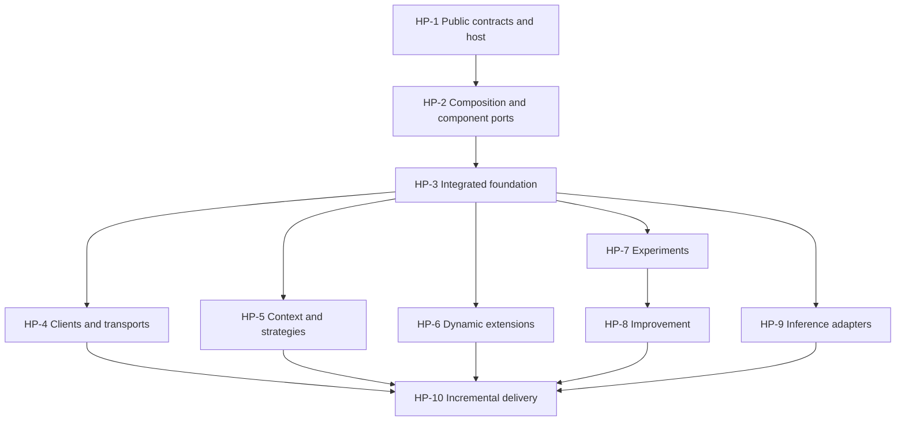

# AW live programmable harness — implementation plan

Author: Prasanna Venkateswaran Loganathar
Co-authors: ChatGPT GPT-6 Astra Pro
Owner: @chatgpt-aw-harness-design (plan coordination)
Date: 2026-11-28 (Asia/Singapore)
Base: `a47492f45813f1e85f85e706e7f33292f0c3e6f0`

Status: **Detailed planning authorized; all runtime implementation phases pending.**
The user accepted the design direction and requires HP-1–3 to establish the whole
shared foundation and declared API surfaces before later components evolve independently.
This document records that boundary and the implementation contracts. It does not
claim runtime changes, a new release, or completion of existing DL-200 gates.

## 1. Reading order and document ownership

1. Repository AGENTS.md and the plan index.
2. [README](README.md), [DESIGN](DESIGN.md), then this implementation map.
3. [API_AND_PROTOCOLS](API_AND_PROTOCOLS.md) for shared names and wire contracts.
4. The phase detail file and affected actual source.
5. [TODO](TODO.md) for unchecked work and current progress.

| Document | Sole responsibility |
|---|---|
| DESIGN.md | Product/architecture rationale, invariants and source evidence map |
| IMPLEMENTATION.md | Dependency order, milestones, cross-plan reconciliation, performance and qualification policy |
| FOUNDATIONS.md | HP-1 through HP-3: public contracts, composition, component interfaces and integrated runtime/SDK/MCP foundation |
| API_AND_PROTOCOLS.md | Canonical proposed public operation, error, capability and transport contracts |
| AUTHORING.md | HP-4 through HP-6: client/transport expansion, richer context/strategy implementations and dynamic extensions |
| LEARNING_AND_DELIVERY.md | HP-7 through HP-10: evaluation, improvement, inference integration, delivery |
| TODO.md | One implementation checklist; completed items later grouped by actual commit |

Use one definition of a shared contract. Phase files link to the protocol document
rather than inventing another envelope, request identity or error taxonomy.
Code and executed results remain the authority for what is implemented.

HP identifiers are local to this plan. They do not extend global numbered phases
past 68 or add an eighth DL-200 phase.

## 2. Engineering contract

The user explicitly requires simple, elegant, composable, reusable Rust libraries;
intuitive public APIs; high performance where a clean implementation permits it;
and focused verification without an elaborate evidence system.

### Reuse before abstraction

- Keep original Runtime/Actor/Message/Envelope and Next/Defer contracts.
- Keep Agent/TurnMachine, journals, Store, Input, JobManager, Process, authority,
  source and disclosure owners.
- Reuse pipeline/routing definitions, revision storage and original effect custody.
- Complete the existing staged leaf registries under the planned single root.
- Share native domain operations across embedded SDK, attached client, CLI and MCP.
- Introduce a trait or crate for a real dependency or substitutability boundary,
  not for each noun in the design.
- Keep pure reusable primitives below product composition. Product defaults belong
  in the host; transport adapters do not implement business logic.

### Rust API and performance rules

| Area | Preferred implementation |
|---|---|
| Identity/revision values | Small typed newtypes; canonical parsing at boundaries |
| Pure transforms and fixed strategies | Concrete enums/functions or generics; borrowed inputs where useful |
| Native service calls | Typed requests/results; no JSON round-trip or transport framing |
| Extension/provider interfaces | Existing dynamic dispatch only at genuinely runtime-selected boundaries |
| Prepared harness | Immutable resolved component order and retained typed handles; no repeated string lookup |
| Shared snapshots | Existing publication/read handles and Arc custody; setup readers outside hot reads |
| Allocation | Bounded Vec buffers reserved once where sizes are known; avoid cloning full histories or definitions |
| Hashing/serialization | At definition/prepare/persistence or wire boundaries, not per token |
| Authority checks | Preserve actual required current-authority fences; cache only immutable resolution, never revoked permissions |
| Observability | Aggregate at model/tool/Turn/Job boundaries; optional bounded detail streams |
| Storage/listing | Existing transactions/indexes/cursors and bounded pages; no history scans on normal admission |
| Concurrency | Existing owner queues/notifiers; short publication fences; no new global lock or background poller |

Zero-cost abstractions are a preference, not a justification for complex type
machinery or code-size growth. Do not introduce custom lock-free structures,
allocators, unsafe fast paths, type-level workflow encodings, broad macro systems,
or bespoke caches without a measured need. Clear efficient code comes first;
targeted optimization follows a demonstrated hot path.

### Public ergonomics

- A default configured Agent remains usable without understanding harness internals.
- Build an editable definition locally; prepare, inspect and activate have separate observable meanings.
- One canonical verb per operation; avoid aliases that acquire different behavior.
- Installation, binding and authority remain distinct but the host supplies
  sensible already-authorized defaults.
- Exact native types stay native; opaque wire handles never stand in for grants.
- Unsupported features are explicit capabilities, not no-op success.
- Names help authors; exact references govern admitted work.
- Ordinary startup starts no new listener, package installation, optimizer,
  discovery scan, or paid request.

## 3. Foundation first, then independent components

HP-1–3 establish the shared architecture across the declared design, including
public native/wire contracts and component extension boundaries. The baseline
embedded SDK, attached SDK and minimal MCP server are part of that foundation.
HP-4 onward adds capability and product depth through those established interfaces.

Foundation completeness has two explicit parts:

- **Executable common substrate:** original owners behind the shared Service,
  default/custom native composition, prepare/activate/recovery, typed native and
  attached operations, bounded observation and a minimal real MCP adapter.
- **Complete declared boundaries:** compile-checked public values, component ports,
  schemas and protocol semantics for every family already in this plan, including
  those whose optional engines arrive later. Owner, authority, budget, lifecycle,
  state, provenance and version behavior are decided here.

Runtime discovery advertises implemented operation support; resource/dependency
readiness is reported separately. An absent optional implementation returns
unsupported before new effects; a supported operation with missing required
resources reports unavailable. Contract availability does not imply runtime support.
Use the shared capability dispatch; do not create an empty manager, background
task or placeholder implementation for each future family.

| Phase | Delivered capability | Hard prerequisites | Independent work after foundation |
|---|---|---|---|
| **HP-1** | Host service and full declared public operation/data contracts; baseline typed owner operations | Existing qualified owners | Pure HP-2 composition work and adapter contract development |
| **HP-2** | Immutable composition/persistence plus typed component, state, host-port and compatibility contracts | HP-1 common contract shape | Baseline implementation of independently owned components |
| **HP-3** | Atomic live runtime and foundation integration through embedded Rust, attached Rust and minimal MCP | HP-1/2; required existing leaf integrity | Closes the shared foundation before component delivery |
| **HP-4** | Client ergonomics, broader export profiles and additional qualified transports | HP-1–3 | HP-5/6/7/9; no component depends on expanded client UX |
| **HP-5** | Richer context, strategy, routing and controller implementations | HP-1–3; only the qualified owners a chosen behavior uses | HP-4/6/7/9 |
| **HP-6** | Expanded Process Extension runtime and TS/JS authoring over established ABI/ports | HP-1–3 | HP-4/5/7/9; no dependency on expanded client surfaces |
| **HP-7** | Experiment execution, evaluation and comparison reports | HP-1–3; qualified environment support only when used | HP-4/5/6/9; native baseline/evaluator is sufficient |
| **HP-8** | Bounded improvement controller and policy-driven promotion | HP-1–3 + HP-7 | HP-4/5/6/9 unless the chosen editable component needs one |
| **HP-9** | Richer optional inference/provider integration | HP-1–3; ordinary Provider behavior is already in the foundation | HP-4/5/6/7/8; paired comparisons optionally use HP-7 |
| **HP-10** | Incremental migration, examples and qualification for a declared shipping subset | The specific capabilities being delivered | Runs alongside each component; no all-components barrier |

Only actual capability dependencies create ordering. For example, an experiment
using a dynamic evaluator needs that HP-6 capability; the native experiment engine
does not. An improvement controller needs HP-7 reports, but not a new client,
dynamic language runtime or ZeroGravity adapter.

Implementation can prototype a component before HP-3. Its public integration
targets the foundation contracts and it cannot claim independent delivery until
the common substrate is qualified. Basic observation, the existing Provider and
a useful default context/strategy already work at foundation exit.

## 4. Coherent milestones

### M1 — complete programmable foundation

Deliver HP-1–3 together as a real usable foundation:

- A normal default Agent and an independently composed native variant use the
  shared Service and existing execution owners.
- The declared public API families have typed request/result contracts, bounded
  schemas and capability/version rules; future families have no hidden domain
  contract still assigned to a later phase.
- Component registration, typed host ports, state/provenance, dependency identity
  and lifecycle rules cover the planned authoring/evaluation/inference components.
- Embedded Rust, attached Rust and a minimal MCP profile perform discovery,
  create/send/observe/cancel and harness prepare/inspect/activate through the
  same operations. External consumers import public crates, not root-private code.
- Busy R1 retains its behavior; the next eligible admission uses R2. Restart
  reconstructs the exact selected closure or reports unavailable.
- Unavailable components are accurately represented without extra runtime owners,
  no-op success, background services or dependencies in portable feature cuts.

Use a real default composition and one meaningful native context/route change.
The consumer example and V1/V2/V7 integration coverage establish this gate; reuse
one native composition scenario from V3. Compile/use the declared contracts as
part of those examples and affected package checks, not a new exhaustive fixture
matrix. V4–V6 qualify optional implementations when those components land.

This milestone already delivers a useful programmable product. Full experiments,
rich Process Extensions and provider-specific integrations are not needed to
establish the foundation, and cannot later invent competing common machinery.

### M2 — independently richer authoring and clients

HP-4/5/6 develop on M1 at their own pace:

- client ergonomics, additional profiles and transports consume established methods;
- context and strategy components offer useful coding/review/delegation behavior;
- TS/JS components register through established contracts and Process custody.

Each component ships its supported subset with a public example. A richer client
does not block native components, and a dynamic runtime does not block native
strategy/evaluation implementations.

### M3 — measured improvement

HP-7/8 use the foundation's observation, budgets, state isolation, report contracts
and activation validation boundary:

- compare baseline/candidate on explicit state and authorized cases;
- retain interpretable quality/cost/latency/outcome records;
- promote through the same fresh binding CAS and configured policy;
- observe a regression and change future selection with compatible state.

The evaluated demonstration from DESIGN.md adds HP-7 to M1; it does not need
HP-4 client expansion. Its evaluator uses the production experiment path rather
than a parallel test-only engine.

### M4 — complementary stack and selected delivery

HP-9 adds the inference capabilities actually supported through the existing
Provider contract and foundation-defined optional reference/capability semantics.
Demonstrate a fixed AW harness across inference targets and a fixed inference
target across harness revisions when the selected adapters are available.

HP-10 integrates and qualifies each declared product subset incrementally.
M2–M4 are capability milestones, not a mandatory serial release train. Publication
remains a separate explicit action.

## 5. Existing DL-200 convergence

| Existing owner/phase | How this plan uses it | Implementation constraint |
|---|---|---|
| Phase 1 Agent/history/access | Canonical Agent scope, immutable history, current ACL generation | No public Session-owner shortcut in the new API |
| Phase 2 Events | Observation and handler progression | Reuse Store-local log/scan/cursor; no second event bus |
| Phase 3 source/checkpoint/Vault | Environment binding, forks, source custody | Expose only qualified operations; preserve maintained/frozen boundaries |
| Phase 4 Agent/Jobs surface | HP-1/3 shared operations and baseline SDK/MCP; HP-4 expansion | One constructor, Input, cancellation and output/ACK owner |
| Phase 5 typed ExtensionRegistry | HP-2/3 component contracts/composition; HP-5 richer contributors | Same leaves and staged publication root; no shadow registry |
| Phase 6 Process Extensions | HP-1/2 shared ABI/port contracts; HP-6 expanded runtime/authoring | Same bounded protocol direction and Process lifetime |
| Phase 7 cleanup/qualification | HP-10 reconciliation | Remove duplicate paths only after real consumers use shared operations |

The current DL-200 queue remains separately owned. This plan supplies a concrete
crosswalk; it does not edit that owner's progress or mark pending gates complete.
At implementation start, the coordinator assigns the actual shared-path owners
and integrates the accepted work. This is routine coordination, not a new
permission checkpoint for each reversible edit.

Do not block host extraction on every unrelated environment feature. Conversely,
a new API cannot imply that physical containment, arbitrary source replacement,
broader disclosure or distributed replay has been qualified.

## 6. Shared contract completion and independent evolution

Establish the whole declared boundary in HP-1/2 and prove its common runtime path
in HP-3. [API_AND_PROTOCOLS](API_AND_PROTOCOLS.md) is the canonical inventory:

1. **Service/public operations:** every already-planned facet's typed request,
   result, selector, reference and bounded validation rules; native/wire projection.
2. **Authority and execution:** host-minted CallContext, semantic operation identity,
   original receipts, cancellation, deadlines, parent budgets and factual uncertainty.
3. **Composition:** immutable definitions/revisions, exact component dependencies,
   native Preparation/PreparedHarness, portable preparation hints and binding CAS.
4. **Component interfaces:** context/strategy/routing/tool/action/hook/resource/event/
   settings/state/view/UI contracts, native-only exclusions, scoped host ports and
   immutable inference/evaluation references.
5. **Lifecycle and state:** preparation, installation/publication, activation,
   continuation retention, state compatibility, retirement and recovery ownership.
6. **Observation and learning integration:** owner-local cursors/projections,
   usage/provenance, experiment/report types and the promotion-validation boundary.
7. **Transport/protocol:** control v2, supported MCP mappings, Process Extension
   successor ABI and compatibility with the existing protocols.

The first supported implementations are deliberately bounded. Later engines
populate the declared interfaces; they do not redefine the common envelope,
state owner, cancellation semantics or authority model. The canonical contract
matrix distinguishes those implementation responsibilities explicitly.

### Component evolution rules

- Component schema/implementation revisions are local to their owning family.
  Registry publication provides atomic composition, not a global component version.
- A component may add internal algorithms, storage indexes and implementation
  optimizations without changing public semantics or requiring unrelated components
  to release. Existing owner migrations govern its actual persisted data.
- Add optional behavior through explicit capabilities and compatible additions;
  a changed behavioral contract gets a versioned interface/adapter.
- Retained revisions select the compatible contract and implementation they admitted.
  New code cannot reinterpret an old continuation or state schema in place.
- Shared types stay small; feature-specific data stays with its component.
  Avoid a universal bag of fields, generic `Any` execution bus or one enum that
  every component must extend to ship an internal improvement.
- New requirements can justify a common-contract change, but make that change
  explicit with its compatibility impact. Existing HP-4–9 work should consume
  complete declared boundaries rather than defer foundational decisions into itself.

This is a supported semantic/version contract, not a promise of an everlasting
Rust source API or dynamically loadable native ABI. Wire target versions and
legacy adapters are specified in the protocol document. Allocate SQLite schema
numbers only after checking the actual implementation baseline.

## 7. Implementation workflow

Each phase detail supplies code areas, operations, persistence/recovery rules and
exit criteria. Implement in coherent vertical slices:

1. Revalidate current HEAD and ownership of the affected paths.
2. Read the original owner and its tests before extracting behavior.
3. Implement the smallest complete consumer path through shared code.
4. Adapt the existing caller so no second behavior path survives unnoticed.
5. Run the focused existing suites and add a test only for a concrete new risk.
6. Record concise results/limitations in the plan; preserve failed/open items.
7. Advance the next dependent consumer or independently owned component.

After HP-3, claim component paths and keep changes within the established public
boundary. An expanded client, evaluator or provider must not require private
root-application imports or a new shared execution/state owner. Component-specific
migrations and versions remain local unless the semantic contract truly changes.

Use one implementation for normalization, domain validation and effect admission.
Transport framing validation may differ by transport; it must call the same
domain validation. Avoid copying the same test into every adapter when one
shared domain test and a small adapter conformance example prove the property.

No commit, push, tag or release is authorized by this planning request. Future
commits preserve signing and exact owned paths. Existing unrelated work and
reserved UX staging remain opaque.

## 8. Focused verification strategy

Use a small set of meaningful scenarios. Phase-level checks elaborate these
scenarios; they are not separate mandatory evidence archives.

| Scenario | Risks it resolves |
|---|---|
| **V1 Shared operations** | Independent native/attached/MCP consumers reach the same Agent/Job owner, with equivalent cancellation and results |
| **V2 Live revision lifecycle** | Busy R1, next eligible R2, binding race, tool/continuation custody, revocation, restart and unavailable dependency |
| **V3 Composed work and state** | Context provenance, bounded controller/delegation, shared budgets, cancellation, isolated old/new and experiment state |
| **V4 Dynamic extension lifecycle** | Describe/install separation, scoped nested calls, frame/deadline bounds, process poison/restart and uncertain effects |
| **V5 Evaluate and promote** | Same cases/baseline, independent scorer, truthful denominators/usage, fresh policy/CAS, regression and future rollback |
| **V6 Inference boundary** | Ordinary provider compatibility, richer capability negotiation, cancellation/usage/unknown mapping, no implicit cross-service atomicity |
| **V7 Product and efficiency** | Feature/dependency cuts, normal startup, examples, targeted admission/observation overhead and absence of duplicate owners |

Unit tests are appropriate for genuinely tricky pure rules such as definition
normalization, compatibility and bounded parsing. Do not produce a test per
accessor/field, duplicate implementation logic in assertions, or require a large
fixture collection merely because APIs are typed.

Test evidence normally consists of command/result, relevant implementation
revision, and an honest limitation note. Runtime receipts needed by the product
remain ordinary functional data. Screenshots, logs and benchmark dumps are
optional diagnostics, not required append-only proof artifacts.

Run broader suites for a concrete dependency/security/storage risk or a required
release gate. Do not rebuild the entire platform matrix after every plan slice.

### Performance qualification

Use existing harnesses where available; add a small benchmark only when a change
affects a real cost center. Compare before/after on the same host/configuration:

- normal startup with live-programming features unused;
- prepared harness admission with increasing component count;
- authorized observation/listing against retained history growth;
- throughput/latency of one hot tool or callback boundary, if changed;
- extension framing overhead separately from native dispatch.

Record what was measured, including allocations or lock contention only when
those metrics resolve a known concern. No arbitrary universal percentage budget
or mandatory microbenchmark for every type. A clear regression is investigated;
an unmeasured optimization is not a completion claim.

## 9. Detailed phase files

- [FOUNDATIONS.md](FOUNDATIONS.md): HP-1 public contracts/service; HP-2 composition
  and component interfaces; HP-3 integrated live runtime and SDK/MCP foundation.
- [AUTHORING.md](AUTHORING.md): HP-4 client/transport expansion; HP-5 richer
  context/strategy implementations; HP-6 dynamic extensions.
- [API_AND_PROTOCOLS.md](API_AND_PROTOCOLS.md): shared API and protocol contract.
- [LEARNING_AND_DELIVERY.md](LEARNING_AND_DELIVERY.md): HP-7 experiments;
  HP-8 improvement; HP-9 inference adapter; HP-10 migration/qualification.
- [TODO.md](TODO.md): implementation progress and the seven verification scenarios.

## 10. Completion meaning

A phase is complete when its documented consumer path works through the original
owners, its relevant focused checks pass, and its known unsupported boundaries
are reflected in capabilities and documentation.

A field in a manifest, a new trait, a mock-only test or an unchecked migration
does not establish the complete capability. Conversely, completion does not
require every optional future provider, executor, platform or UI to exist.

The default AW product remains useful throughout migration. The full programmable
stack is built by connecting reusable, exercised pieces rather than accumulating
parallel abstractions.
