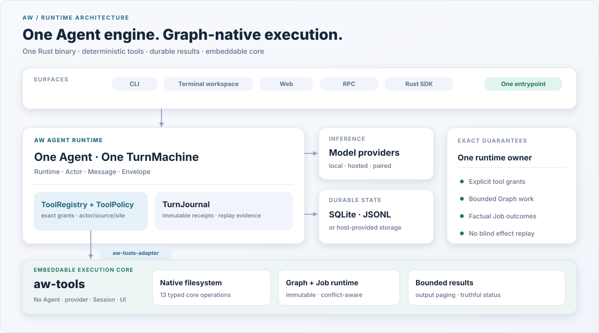
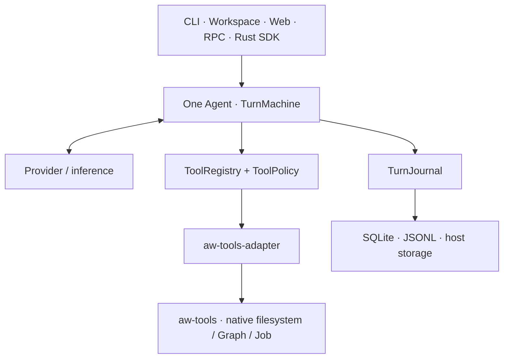
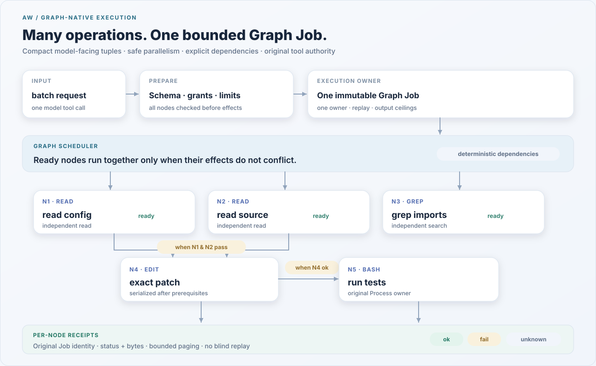
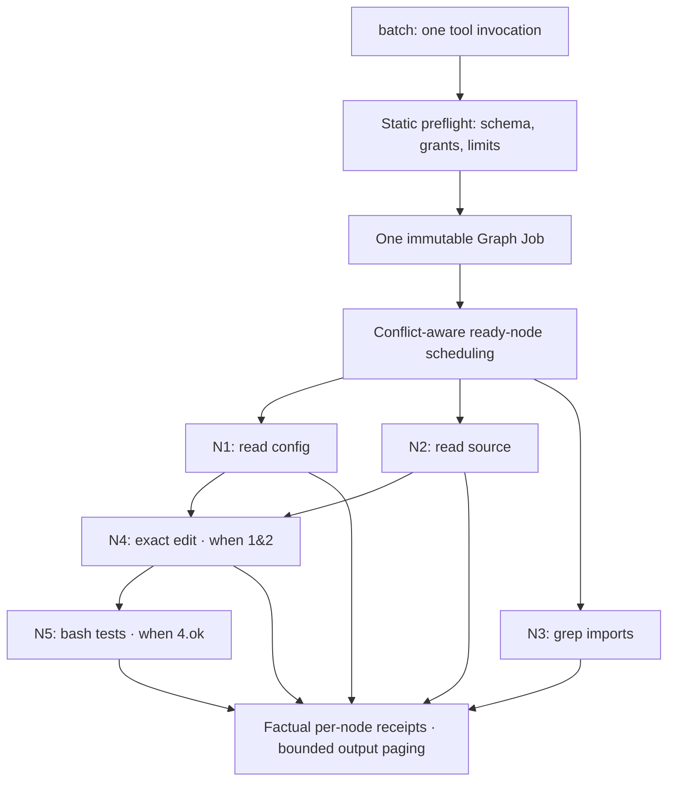

# aw

**The durable graph-native agent runtime and workspace. One Rust binary, one Agent engine, composable everywhere.**

## Intro

- **Graph-native execution:** bounded, immutable tool Graphs with dependencies, conflict-aware parallelism and factual per-node results.
- **AI-native tools:** compact direct filesystem and Process tools that compose as Graph nodes, backed by the embeddable `aw-tools` Rust library.
- **Durable work:** Sessions, branches, context imports, Job output and immutable model/tool receipts.
- **Interactive or automated:** terminal chat, Files/Git/terminal workspace, web UI, JSONL and typed RPC.
- **Independent inference:** local models, hosted APIs and paired devices; credentials stay with their configured executor.
- **One Agent engine:** shared runtime semantics across the Rust SDK, full/minimal CLI, portable `no_std + alloc` Agent and C ABI; hosted execution composes child Agents, Processes, hooks and pipelines.

[Quick start](#quick-start) · [Architecture](#architecture) · [FAQ](#faq) · [Roadmap](#implementation-status-and-roadmap)

## Quick start

### Install from source

Use the pinned toolchain and Nix dependencies:

```sh
git clone https://github.com/abird-ai/aw.git
cd aw
nix develop
cargo install --locked --path . --bin aw
aw
```

An unconfigured interactive launch offers provider/model setup. Or use
[configuration](examples/config.toml) or explicit flags.

### Work

With a configured provider:

```sh
aw "Explain this repository"
aw --output-print "Summarize this change"
aw --session-resume
aw --ui-mode workspace
```

With a local OpenAI-compatible server’s model alias:

```sh
aw --provider-profile llama --model-id MODEL \
  --provider-base-url http://127.0.0.1:8080/v1 \
  --output-print "Explain Rust ownership"
```

Grant project read access:

```sh
aw --workspace-directory /path/to/project \
  --tools-mode read-only --tools-allow read \
  --output-print "Review the source"
```

Tools are **off by default**. Instructions and skills grant no tools.
When authorized, `batch` composes native operations into a bounded Graph without widening their individual grants.
aw connects to inference servers; it does not download model weights.

### Integrate

```sh
aw --output-format jsonl --output-print "Hello"
aw rpc --agent-stdio
aw --help
aw cli schema
```

[RPC client examples](examples/sdk-rpc-client/README.md) ·
[browser entry point](.agents/docs/BROWSER-WORKSPACE.md)

## Architecture

<picture>
  <source media="(prefers-color-scheme: dark)"
          srcset="docs/diagrams/aw-runtime-architecture-dark.svg">
  
</picture>

<details>
<summary>Architecture as Mermaid</summary>



</details>

**Exactly four Runtime primitives:**

| Primitive | Contract |
| --- | --- |
| **Runtime** | Bounded scheduling, ownership, continuations, shutdown |
| **Actor** | Generation-fenced Agent or Process; exact owner and site |
| **Message** | Addressed Control, Input, Notify or Hook communication |
| **Envelope** | Immutable authority/resource ceiling; children only narrow it |

**Two Hook verbs:** `Next` continues/replaces/consumes; `Defer` parks a bounded
continuation. Queues, approvals, routing and child Sessions compose over these.

**Graph-native execution:** `batch` compiles fixed native-tool nodes and `when`
dependencies; preflight checks grants and resource conflicts, then schedules
ready nodes in parallel where safe. Per-node outcomes, output paging and
cancellation remain factual. No additional Agent engine is created per Graph.

<picture>
  <source media="(prefers-color-scheme: dark)"
          srcset="docs/diagrams/aw-graph-execution-dark.svg">
  
</picture>

<details>
<summary>Graph execution as Mermaid</summary>



</details>

**Embeddable core:** `aw-tools` provides typed filesystem operations and
bounded Graph/Job semantics with read-only, rw and batch feature sets.
It needs no AW Session, provider, UI or Agent loop and is reused by dotlink.

### Key decisions

- **One Agent engine:** original TurnMachine, ToolRegistry, ToolPolicy and TurnJournal across surfaces; Graph/Job execution uses shared `aw-tools`.
- **Model-first tool language:** short, typed native operations and compact Graph tuples; avoid repeated model turns for independent work.
- **Deterministic Graphs:** immutable dependencies, conservative conflict scheduling, bounded outputs and truthful `ok`/`fail`/`unknown` results.
- **Explicit authority:** exact actor/source/site grants per operation and Graph leaf; prompts, plugins and peer pairing confer none.
- **Intent before effect:** journal before dispatch; preserve uncertainty; never blindly replay unknown charges or effects.
- **Separate custody:** account, payer, credentials, inference host and tool host remain distinct.
- **Portable core:** the Agent kernel needs no UI, network, OS process or database; `aw-tools` is independently embeddable.

**Domain → Workspace → Session.** Sessions hold branches and immutable history;
Machines/Fleets identify targets. Views cannot retarget running work.

## Engineering

- [Runtime](.agents/docs/RUNTIME-FOUR-PRIMITIVES-AND-SERVICES-2026-10-11.md)
- [AI-native tools and DL-150 Graph/Job semantics](.agents/docs/TOOLS.md)
- [Embeddable `aw-tools` library](crates/aw-tools/README.md)
- [Unified Jobs + Agent runtime (vNext design)](.agents/plans/ai-native-unified-jobs-agent-runtime-2026-11-11/README.md)
- [Hook/trust policies](.agents/docs/RUNTIME-HOOKS-TRUST-AND-POLICY-2026-10-11.md)
- [SDK](.agents/docs/SDK.md)
- [C ABI](crates/aw-embedded-ffi/README.md)
- [CLI](.agents/docs/CLI.md)
- [State](.agents/docs/STATE.md)
- [Validation/release TODOs](.agents/plans/release-readiness/TODO.md)
- [Development handoff](.agents/plans/START_HERE.md)

Full builds are the default. Build minimal with:

```sh
cargo build --locked -p aw-cli --bin aw --no-default-features --features minimal
```

Omit `--features minimal` for stateless. Implementation detail lives in
[.agents/docs](.agents/docs/) and [.agents/plans](.agents/plans/).

Build and audit all release artifacts into a dedicated output directory:

```sh
bash scripts/build-release-artifacts.sh dist
```

The previous output is replaced atomically only after the new artifacts are
staged. Build failures preserve it; directories containing unrelated files are
refused. Cross-builds do not establish native Windows/macOS/ARM runtime
qualification or authorize publication.
The helper requires Linux atomic directory exchange (`renameat2`); unsupported
filesystems fail before replacing output. Existing nonempty output must contain
the complete flat release-file set, with no symlinks or unrelated entries.

## Implementation status and roadmap

Source **0.15.0** · SQLite **v33** · JSONL **v1**.

| Implemented | Next / deferred |
| --- | --- |
| Agent, terminal/web workspace, unified palette/focus, JSONL/RPC, Rust SDK | Further UX v1.5 viewer/layout convergence |
| Embeddable `aw-tools` native filesystem, bounded Graph/Job execution and output paging | Unified Jobs/Agent controls and Graph/Node delegation (vNext design, not yet shipped) |
| Runtime primitives, hooks, queues, processes, bounded delegation/reviews | Further integrations within existing boundaries |
| Durable history, branches, context flow, quarantined backup inspection | Runnable restoration: fresh human authority, cross-host exclusivity, reconciled effects; activation disabled |
| Domain/Workspace/Machine/Fleet, pairing, bounded remote/team/account services | Broader distributed workflows; independent security qualification |
| Portable Agent, executed WASM/Linux libc-free host, tested C ABI | Native multi-platform release qualification; firmware parked |

Evidence covers local Linux, mock providers and specified embedded hosts—not
production billing or every platform. Indexing and LSP are intentionally excluded.
See the concise [plan index](.agents/plans/TODO.md) and [accepted checkpoint](.agents/plans/accepted-history/TODO.md).

The hosted account catalog uses [left-right 0.11.8](https://github.com/jonhoo/left-right)
with task-owned readers and fresh grant checks. Measured fit keeps streaming projections and bounded resource
owners simple. Future publication changes require measured read-heavy fit and
retain the existing authority/resource owners.

The unified palette/focus slice
uses `F1` or `Ctrl+Shift+P` (browser also `Ctrl/Cmd+K`) with the same seven
resource prefixes. Native and browser interaction, focus and visual checks are
verified locally. Further UX v1.5 viewers, compound Files/Git views, docks and
breakouts remain in the [workspace views plan](.agents/plans/workspace-views/TODO.md).

## FAQ

**Which providers?** Native Ollama, OpenAI Chat Completions/Responses, Anthropic,
Gemini and explicit OpenAI-compatible endpoints. [Provider guide](crates/aw-providers/README.md).

**Without SQLite or a UI?** Minimal uses JSONL; stateless uses memory. Rust/C hosts
can embed the engine without terminal, HTTP or SQLite dependencies.

**What does graph-native mean?** `batch` runs a bounded Graph of native operations
with explicit dependencies (`when`), safe concurrent scheduling and per-node
results. Graph execution uses the same ToolPolicy and Job semantics as direct tools.

**Can I embed just the tools?** Yes. `aw-tools` exposes the reusable Rust filesystem,
Graph and Job core without an AW Agent, Session, model provider or UI.

**Are extensions sandboxed?** Process extensions are explicitly started trusted
programs. MCP discovery grants nothing; tool access requires exact host approval.

**After a crash?** Receipts preserve known results and unknown outcomes. Restored
backups cannot execute historical work.

## Contributing

We build aw in the open and would love your ideas, architectural challenges,
research, and focused improvements. See [CONTRIBUTING.md](CONTRIBUTING.md) for
the best ways to take part.

## AI disclosure

**Human-centric design. AI-centric implementation.** aw is built with extensive
AI assistance for research, code, tests, and documentation. We believe the best
software comes from human-led design and AI-assisted implementation: humans own
the architecture, priorities, and acceptance criteria, while AI helps implement,
test, and iterate. We don't hand direction to autonomous models or claim every
generated line is manually reviewed — correctness rests on explicit designs,
reproducible tests, and continuous validation.

## License

[MIT](LICENSE) © 2026 Prasanna Loganathar and aw contributors. Third-party libraries and assets retain their
respective licenses.
