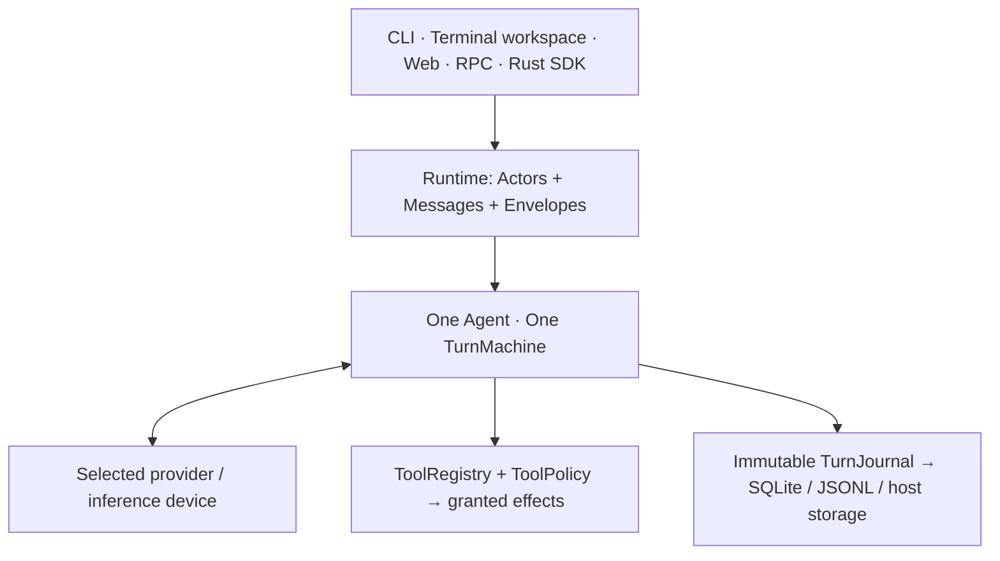

# aw

**A durable AI workspace. One Rust binary, one Agent engine, composable everywhere.**

## Intro

- **Interactive or automated:** terminal chat, Files/Git/terminal workspace, web UI, JSONL and typed RPC.
- **Durable work:** Sessions, branches, context imports and immutable model/tool receipts.
- **Independent inference:** local models, hosted APIs and paired devices; credentials stay with their configured executor.
- **Composable execution:** child Agents, processes, queues, hooks, reviews and pipelines; explicit authority throughout.
- **One shared engine:** Rust SDK, full/minimal CLI, portable `no_std + alloc` Agent and C ABI.

[Quick start](#quick-start) · [Architecture](#architecture) · [FAQ](#faq) · [Roadmap](#implementation-status-and-roadmap)

## Quick start

### Install from source

Use the pinned toolchain and Nix dependencies:

```sh
git clone https://github.com/abird-ai/aw.git
cd aw
nix develop
cargo install --locked --path . --bin aw
aw
```

An unconfigured interactive launch offers provider/model setup. Or use
[configuration](examples/config.toml) or explicit flags.

### Work

With a configured provider:

```sh
aw "Explain this repository"
aw --output-print "Summarize this change"
aw --session-resume
aw --ui-mode workspace
```

With a local OpenAI-compatible server’s model alias:

```sh
aw --provider-profile llama --model-id MODEL \
  --provider-base-url http://127.0.0.1:8080/v1 \
  --output-print "Explain Rust ownership"
```

Grant project read access:

```sh
aw --workspace-directory /path/to/project \
  --tools-mode read-only --tools-allow read \
  --output-print "Review the source"
```

Tools are **off by default**. Instructions and skills grant no tools.
aw connects to inference servers; it does not download model weights.

### Integrate

```sh
aw --output-format jsonl --output-print "Hello"
aw rpc --agent-stdio
aw --help
aw cli schema
```

[RPC client examples](examples/sdk-rpc-client/README.md) ·
[browser entry point](.agents/docs/BROWSER-WORKSPACE.md)

## Architecture



**Exactly four Runtime primitives:**

| Primitive | Contract |
| --- | --- |
| **Runtime** | Bounded scheduling, ownership, continuations, shutdown |
| **Actor** | Generation-fenced Agent or Process; exact owner and site |
| **Message** | Addressed Control, Input, Notify or Hook communication |
| **Envelope** | Immutable authority/resource ceiling; children only narrow it |

**Two Hook verbs:** `Next` continues/replaces/consumes; `Defer` parks a bounded
continuation. Queues, approvals, routing and child Sessions compose over these.

### Key decisions

- **One execution path:** original Agent, TurnMachine, ToolRegistry, ToolPolicy and TurnJournal across surfaces.
- **Explicit authority:** exact actor/source/site grants; prompts, plugins and peer pairing confer none.
- **Intent before effect:** journal before dispatch; preserve uncertainty; never automatically replay unknown charges or effects.
- **Separate custody:** account, payer, credentials, inference host and tool host remain distinct.
- **Small portable core:** no UI, network, OS-process or database dependencies in the kernel.

**Domain → Workspace → Session.** Sessions hold branches and immutable history;
Machines/Fleets identify targets. Views cannot retarget running work.

## Engineering

- [Runtime](.agents/docs/RUNTIME-FOUR-PRIMITIVES-AND-SERVICES-2026-10-11.md)
- [Hook/trust policies](.agents/docs/RUNTIME-HOOKS-TRUST-AND-POLICY-2026-10-11.md)
- [SDK](.agents/docs/SDK.md)
- [C ABI](crates/aw-embedded-ffi/README.md)
- [CLI](.agents/docs/CLI.md)
- [State](.agents/docs/STATE.md)
- [Validation/release TODOs](.agents/plans/release-readiness/TODO.md)
- [Development handoff](.agents/plans/START_HERE.md)

Full builds are the default. Build minimal with:

```sh
cargo build --locked -p aw-cli --bin aw --no-default-features --features minimal
```

Omit `--features minimal` for stateless. Implementation detail lives in
[.agents/docs](.agents/docs/) and [.agents/plans](.agents/plans/).

Build and audit all release artifacts into a dedicated output directory:

```sh
bash scripts/build-release-artifacts.sh dist
```

The previous output is replaced atomically only after the new artifacts are
staged. Build failures preserve it; directories containing unrelated files are
refused. Cross-builds do not establish native Windows/macOS/ARM runtime
qualification or authorize publication.

## Implementation status and roadmap

Source **0.15.0** · SQLite **v33** · JSONL **v1**.

| Implemented | Next / deferred |
| --- | --- |
| Agent, terminal/web workspace, unified palette/focus, JSONL/RPC, Rust SDK | Further UX v1.5 viewer/layout convergence |
| Runtime primitives, hooks, queues, processes, bounded delegation/reviews | Further integrations within existing boundaries |
| Durable history, branches, context flow, quarantined backup inspection | Runnable restoration: fresh human authority, cross-host exclusivity, reconciled effects; activation disabled |
| Domain/Workspace/Machine/Fleet, pairing, bounded remote/team/account services | Broader distributed workflows; independent security qualification |
| Portable Agent, executed WASM/Linux libc-free host, tested C ABI | Native multi-platform release qualification; firmware parked |

Evidence covers local Linux, mock providers and specified embedded hosts—not
production billing or every platform. Indexing and LSP are intentionally excluded.
See the concise [plan index](.agents/plans/TODO.md) and [accepted checkpoint](.agents/plans/accepted-history/TODO.md).

The hosted account catalog uses [left-right 0.11.8](https://github.com/jonhoo/left-right)
with task-owned readers and fresh grant checks. Measured fit keeps streaming projections and bounded resource
owners simple. Future publication changes require measured read-heavy fit and
retain the existing authority/resource owners.

The unified palette/focus slice
uses `F1` or `Ctrl+Shift+P` (browser also `Ctrl/Cmd+K`) with the same seven
resource prefixes. Native and browser interaction, focus and visual checks are
verified locally. Further UX v1.5 viewers, compound Files/Git views, docks and
breakouts remain in the [workspace views plan](.agents/plans/workspace-views/TODO.md).

## FAQ

**Which providers?** Native Ollama, OpenAI Chat Completions/Responses, Anthropic,
Gemini and explicit OpenAI-compatible endpoints. [Provider guide](crates/aw-providers/README.md).

**Without SQLite or a UI?** Minimal uses JSONL; stateless uses memory. Rust/C hosts
can embed the engine without terminal, HTTP or SQLite dependencies.

**Are extensions sandboxed?** Process extensions are explicitly started trusted
programs. MCP discovery grants nothing; tool access requires exact host approval.

**After a crash?** Receipts preserve known results and unknown outcomes. Restored
backups cannot execute historical work.

## Contributing

**We are building aw in the open with you.** We'd love your ideas, architectural
challenges, research, and thoughtful improvements. We believe the best way to
develop software is with human-led design and AI-led implementation. Bring a use case, reproducible failure or focused change.

## AI disclosure

**Human-centric design. AI-centric implementation.** aw is built with extensive AI
assistance for research, code, and tests. Humans lead the architecture, priorities,
and acceptance criteria. We neither hand over direction to autonomous models nor
claim that every generated line is manually reviewed. We rely on explicit designs,
reproducible tests, engineering evidence, and continuous validation.

## License

[MIT](LICENSE) © 2026 Prasanna Loganathar and aw contributors. Third-party libraries and assets retain their
respective licenses.
