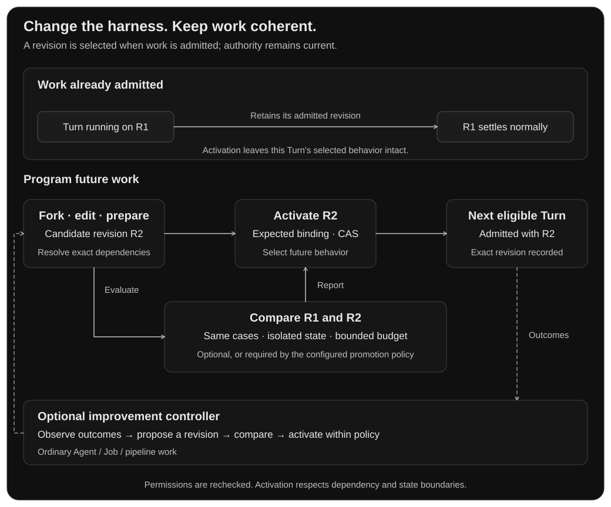
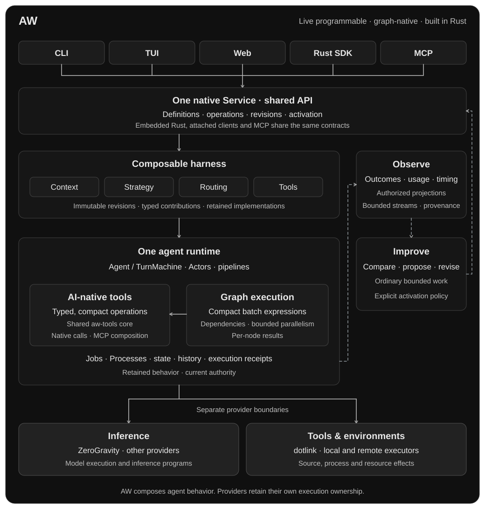

# aw

**The blazingly fast, graph-native agent harness you can program live.**

Compose AI-native tools, context, strategies and graphs of work. Make the harness
yours—and let your agents help it evolve.

One native runtime, from a personal coding workspace to an autonomous stack.

[Quick start](#quick-start) · [Rust SDK](#sdk-in-a-few-lines) ·
[Tools and graphs](#ai-native-tools-graph-native-execution) ·
[Live programming](#program-the-running-harness) · [Architecture](#architecture) ·
[Roadmap](#roadmap)

## Quick start

Start in the terminal, open the workspace, or use the browser:

```sh
aw
aw workspace
aw web
```

On first launch, choose a provider and model. Work with local inference, hosted
APIs or a configured ZeroGravity endpoint.

```sh
aw -C . --tools-mode read-only "Explain this repository"
aw --output-print "Explain Rust ownership"
aw --session-resume
```

Tool access belongs to the workspace's configured grants. The read-only example
explicitly permits inspection; instructions and prompts do not grant access.

<details>
<summary>Install from source</summary>

Use the repository's pinned toolchain and dependencies:

```sh
git clone https://github.com/abird-ai/aw.git
cd aw
nix develop
cargo install --locked --path . --bin aw
aw
```

</details>

<details>
<summary>Connect a local inference server</summary>

Use the server's model alias and OpenAI-compatible endpoint:

```sh
aw --provider-profile llama \
  --model-id MODEL \
  --provider-base-url http://127.0.0.1:8080/v1 \
  --output-print "Explain Rust ownership"
```

AW connects to inference providers. Model weights and device execution stay with
the inference service.

</details>

[CLI guide](.agents/docs/CLI.md) · [Configuration](examples/config.toml) ·
[Provider guide](crates/aw-providers/README.md) ·
[Browser workspace](.agents/docs/BROWSER-WORKSPACE.md)

## SDK in a few lines

Embed the service in your application. `config` supplies its provider, workspace
and allowed tools; a new Agent uses those configured defaults.

```rust
use aw_host::{AgentSpec, Service};

let service = Service::embedded(config).await?;
let aw = service.client();

let agent = aw.agents().create(AgentSpec::new("reviewer")).await?;
let result = agent.run("Review the architecture of this repository").await?;

service.shutdown().await?;
```

Or connect to an existing service:

```rust
let aw = aw_client::Client::connect(endpoint).await?;
```

Use `aw_host` for embedding and `aw_client` for attached applications; both
export the shared request types. Embedded calls stay native Rust.
`run` submits once and waits for the original execution; longer workflows can
retain their operation handle, observe progress and cancel explicitly.

The lower-level `AgentBuilder`, portable `no_std + alloc` kernel and C ABI are
available for hosts that supply their own execution and storage.

[SDK guide](.agents/docs/SDK.md) ·
[API contracts](.agents/plans/live-programmable-harness-2026-11-28/API_AND_PROTOCOLS.md) ·
[Embedding examples](examples/sdk-host/README.md)

## AI-native tools, graph-native execution

AW's core tools have been redesigned from first principles to be **model-native**:
compact schemas and results, exact edits, bounded reads and searches, and clear
status for completion, pagination and partial work. Direct and graph calls share
the same operation schemas, implementations and permission checks.

Read the [AI-native tools design specification](.agents/plans/dotlink-tool-port/reference/DL150-SEALED-c34ea5a-README.md#design-principles)
for the rationale, operation contracts and output formats.

| Work | Native tools |
| --- | --- |
| **Inspect** | `ls`, `grep`, `read`, `bread` |
| **Change** | `write`, `edit`, `patch`, `cp`, `mv`, `rm` |
| **Execute and delegate** | `bash`, `pwsh` / `powershell`, `agent` |
| **Compose and observe** | `batch`, `jobs_get`, `jobs_read`, `jobs_cancel` |

The **AI-native graph runtime** turns native tools, Processes and authorized
child Agents into bounded graphs of work. **`batch` is its compact model-facing
interface.** A node is `[tool, args, when?]`: describe independent actions and
guarded dependencies in one call, then let AW schedule ready work within its
conflict, resource and authority limits.

After inspecting a Rust project and choosing the edits, an agent can submit
these `batch` arguments:

```json
{
  "ops": [
    ["edit", {
      "path": "src/config.rs",
      "edits": [["MAX_RETRIES: usize = 2", "MAX_RETRIES: usize = 3"]]
    }, "*"],
    ["edit", {
      "path": "tests/config.rs",
      "edits": [["assert_eq!(max_retries(), 2)", "assert_eq!(max_retries(), 3)"]]
    }, "*"],
    ["bash", {"command": "cargo fmt --check"}, "1&2"],
    ["bash", {"command": "cargo test"}, "3"]
  ]
}
```

`*` marks independent work. The two edits can run concurrently when host policy
allows. `1&2` requires both edits to finish successfully and completely before
the format check; `3` applies the same condition to the check before tests run.
Unmet conditions skip dependent work, and each node retains its own factual
result. One model decision expresses the known action plan, reducing avoidable
round trips between steps.

Arguments are fixed when the graph is admitted. When later actions need earlier
output, the calling agent reads the results and prepares the next graph. Use the
same Job controls to observe progress, read output and cancel work. Finite action
graphs handle tool execution; durable pipelines handle longer, multi-turn workflows.

Filesystem algorithms, graph compilation and Job management live in the reusable
`aw-tools` library. AW binds them to its Agent runtime and execution owners;
other Rust applications can embed the same core.

[Tools and execution guide](.agents/docs/TOOLS.md) ·
[Shared Rust tools](crates/aw-tools/README.md)

## Make the harness yours

A harness is a composition of reusable components. Start with a useful default,
then replace the parts that make your agent distinctive.

| Component | What you control |
| --- | --- |
| **Context** | Instructions, source selection, history, summaries and memory |
| **Strategy** | Planning, delegation, review, repair and stopping rules |
| **Routing** | Which authorized model or inference target handles each kind of work |
| **Tools and actions** | Native capabilities, action graphs, MCP integrations and bounded workflows |
| **State and events** | Component state, settings, subscriptions and reactions |
| **Environment** | Workspace sources, checkpoints and configured execution targets |
| **Evaluation** | Case sets, scorers, comparisons and promotion policy |

These examples use an active `aw` client. Component references such as
`repo_context` and `plan_work_review` identify registered, typed implementations.

```rust
use aw_host::{AgentSpec, HarnessDefinition};

let definition = HarnessDefinition::new("code-review")
    .context(repo_context)
    .strategy(plan_work_review)
    .route(model_route)
    .toolset(workspace_tools);

let candidate = aw.harnesses().prepare(definition).await?;
let reviewer = aw.agents().create(
    AgentSpec::new("reviewer").harness(candidate.revision())
).await?;
```

Preparation resolves the composition into an immutable revision. Native Rust
components retain typed handles; portable definitions refer to exact components.
Use the same building blocks in a coding workspace, a research team or a
domain-specific assistant.

Author components in Rust, compose registered behavior declaratively, or use
TS/JS Process Extensions with scoped host access.

## Program the running harness

Inspect an Agent's current binding, change one part, compare the candidate and
activate it for future work. Admitted work keeps the revision it started with.

Here, `agent` is an existing Agent, `focused_context` is a registered context
component, and `comparison` supplies your cases, evaluator, initial state,
effect policy and total budget.

```rust
use aw_host::{ActivationRequest, ExperimentSpec};

let current = agent.harness().await?;
let mut draft = aw.harnesses().fork(current.revision()).await?;
draft.context = focused_context;

let candidate = aw.harnesses().prepare(draft).await?;
let report = aw.experiments().compare(ExperimentSpec {
    baseline: current.revision().clone(),
    candidate: candidate.revision().clone(),
    ..comparison
}).await?.wait().await?;

aw.harnesses().activate(
    ActivationRequest::next_turn(
        agent.id(), candidate.revision(), current.binding_revision()
    ).evidence(report.id())
).await?;
```

The comparison runs on isolated mutable state and returns a sealed report.
Activation checks the current binding and configured promotion policy. A
competing edit produces a conflict; selecting a prior compatible revision changes
future behavior.



**Make improvement part of the harness.** Give an ordinary agent a bounded edit
space, an evaluator and a promotion policy. It can propose revisions, run
comparisons and activate permitted improvements through the same operations.
Its children share the budget, and the candidate cannot rewrite its evaluator
or grant itself more authority.

Current permission checks remain live. Stateful components and retained tool
calls keep their compatibility and lifetime boundaries when revisions change.

[Composition and authoring](.agents/plans/live-programmable-harness-2026-11-28/AUTHORING.md) ·
[Evaluation and improvement](.agents/plans/live-programmable-harness-2026-11-28/LEARNING_AND_DELIVERY.md)

## Give agents the same programming interface

Expose AW through MCP:

```sh
aw mcp serve --stdio --mcp-profile authoring
```

Agents can inspect compositions, prepare revisions, run comparisons, observe
work and activate authorized changes. MCP calls use the same native operations
as the SDK. Export profiles select the available tools; the host controls access.

For shell automation and direct RPC clients:

```sh
aw --output-format jsonl --output-print "Hello"
aw rpc --agent-stdio
aw cli schema
```

MCP and AW's direct RPC are separate adapters over the same service.

## Architecture



**One service, one Agent runtime.** CLI, terminal workspace, Web, Rust SDK and
MCP use shared operations. Harness definitions compose context, strategies,
routing and capabilities over the original Agent engine.

The runtime owns admission, bounded work, cancellation and execution history.
Components own their implementations and state contracts. A revision selects a
coherent composition; changes become effective at explicit admission boundaries.

Native tools, graph execution, Processes, child Agents and workflows reuse the
same authority and execution owners. Journals preserve actual results and uncertain outcomes across
interruptions. Observation and evaluation feed the next revision through the
same programming interface.

### A fast path built for Rust

- **Typed native calls.** Rust embedders work with concrete values and handles.
  Serialization belongs at transport boundaries.
- **Prepared composition.** Resolve dependencies and component order once,
  then reuse the immutable selection during execution.
- **Native tools.** Filesystem operations use shared Rust algorithms directly;
  shell execution is an explicit capability.
- **Graph execution.** Compact batches reduce model round trips. Independent
  work runs concurrently within conflict, resource and authority limits.
- **Reusable libraries.** Embed the Agent engine or just `aw-tools`; retain
  portable `no_std + alloc`, stateless and durable configurations.
- **Focused observation.** Record lifecycle and decision facts, with bounded
  detail when needed.

### AW and ZeroGravity

| Layer | What it programs |
| --- | --- |
| **AW** | Agent context, behavior, tools, action graphs, collaboration, state and environments |
| **[ZeroGravity](https://github.com/abird-ai/zerogravity)** | Models, inference pipelines, kernels, scheduling and device resources |
| **Your application** | Goals, domain behavior and the experience built above them |

AW selects an inference target; ZeroGravity executes inference. Each has its own
revisions and lifecycle. Use them together as a programmable autonomous stack,
or use either with other compatible providers.

## Engineering

- [Architecture and design](.agents/plans/live-programmable-harness-2026-11-28/DESIGN.md)
- [Shared foundation](.agents/plans/live-programmable-harness-2026-11-28/FOUNDATIONS.md)
- [SDK, API and protocols](.agents/plans/live-programmable-harness-2026-11-28/API_AND_PROTOCOLS.md)
- [Runtime primitives](.agents/docs/RUNTIME-FOUR-PRIMITIVES-AND-SERVICES-2026-10-11.md)
- [Tools, Graphs and Jobs](.agents/docs/TOOLS.md) · [Embeddable tools](crates/aw-tools/README.md)
- [Local shell containment](.agents/docs/TOOLS.md#local-shell-containment)
- [Hooks and policy](.agents/docs/RUNTIME-HOOKS-TRUST-AND-POLICY-2026-10-11.md)
- [C ABI](crates/aw-embedded-ffi/README.md) · [State](.agents/docs/STATE.md)

Full builds are the default. Build the minimal CLI with:

```sh
cargo build --locked -p aw-cli --bin aw --no-default-features --features minimal
```

Omit `--features minimal` for stateless operation. See the
[development guide](CONTRIBUTING.md) for repository workflow and
[release qualification](.agents/plans/release-readiness/TODO.md) for platform checks.

## Roadmap

Implementation progress, platform support and component milestones live in the
engineering plans:

[Implementation phases](.agents/plans/live-programmable-harness-2026-11-28/IMPLEMENTATION.md) ·
[Work queue](.agents/plans/live-programmable-harness-2026-11-28/TODO.md) ·
[Current handoff](.agents/docs/CURRENT_HANDOFF.md)

## FAQ

**What does “you can program live” mean?** You can program each harness layer while
AW runs—directly, from your software through the SDK, or through an agent using
MCP. Compose and change context, strategies, routing, tools, workflows and
environment behavior. Your agent can build its own harness, learn from results,
compare alternatives and iterate on how it works—even between individual turns.

Compatible revisions activate at the next eligible boundary. Work already in
flight keeps its original revision; permissions, budgets and promotion policy
continue to apply.

**Can I bring my own model?** Yes. Use local or hosted inference through native
providers, explicit OpenAI-compatible endpoints or ZeroGravity.

**Can I embed only part of AW?** Yes. The Agent kernel, hosted SDK, portable C ABI
and `aw-tools` expose reusable layers. The host selects its own providers,
storage and execution capabilities.

**What happens to work during a revision change?** Admitted work keeps its exact
revision. Future eligible work adopts the selected binding. Current permission
checks and component state compatibility still apply.

**Can an agent improve its own harness?** Yes, within its configured edit space,
budget and promotion policy, using the same preparation, evaluation and
activation operations available to a developer.

**Are Process Extensions a sandbox?** They are explicitly started programs with
scoped AW access. Running untrusted executable code requires a qualified
isolation boundary from the host.

## Related projects

- **[ZeroGravity](https://github.com/abird-ai/zerogravity)** — live programmable
  inference, from model programs and pipelines to device execution.
- **[dotlink](https://github.com/abird-ai/dotlink)** — scoped MCP access to local
  files, tools and execution, built on shared AW libraries.

## Contributing

We build aw in the open and would love your ideas, architectural challenges,
research, and focused improvements. See [CONTRIBUTING.md](CONTRIBUTING.md) for
the best ways to take part.

## AI disclosure

**Human-centric design. AI-centric implementation.** aw is built with extensive
AI assistance for research, code, tests, and documentation. We believe the best
software comes from human-led design and AI-assisted implementation: humans own
the architecture, priorities, and acceptance criteria, while AI helps implement,
test, and iterate. We don't hand direction to autonomous models or claim every
generated line is manually reviewed — correctness rests on explicit designs,
reproducible tests, and continuous validation.

## License

[MIT](LICENSE) © 2026 Prasanna Loganathar and aw contributors. Third-party libraries and assets retain their
respective licenses.
