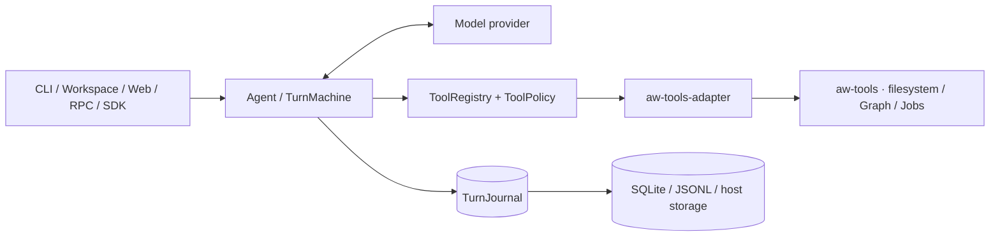
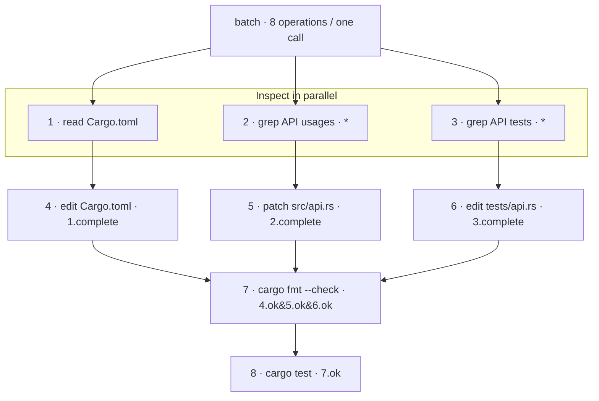
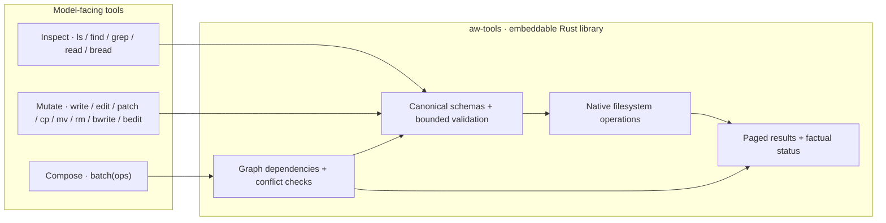

# aw

**The durable graph-native agent runtime and workspace. One Rust binary, one Agent engine, composable everywhere.**

## Intro

- **Graph-native execution:** bounded, immutable tool Graphs with dependencies, conflict-aware parallelism and factual per-node results.
- **AI-native tools:** compact direct filesystem and Process tools that compose as Graph nodes, backed by the embeddable `aw-tools` Rust library.
- **Durable work:** Sessions, branches, context imports, Job output and immutable model/tool receipts.
- **Interactive or automated:** terminal chat, Files/Git/terminal workspace, web UI, JSONL and typed RPC.
- **Independent inference:** local models, hosted APIs and paired devices; credentials stay with their configured executor.
- **One Agent engine:** shared runtime semantics across the Rust SDK, full/minimal CLI, portable `no_std + alloc` Agent and C ABI; hosted execution composes child Agents, Processes, hooks and pipelines.

[Quick start](#quick-start) · [Architecture](#architecture) · [FAQ](#faq) · [Roadmap](#implementation-status-and-roadmap)

## Quick start

### Install from source

Use the pinned toolchain and Nix dependencies:

```sh
git clone https://github.com/abird-ai/aw.git
cd aw
nix develop
cargo install --locked --path . --bin aw
aw
```

An unconfigured interactive launch offers provider/model setup. Or use
[configuration](examples/config.toml) or explicit flags.

### Work

With a configured provider:

```sh
aw "Explain this repository"
aw --output-print "Summarize this change"
aw --session-resume
aw --ui-mode workspace
```

With a local OpenAI-compatible server’s model alias:

```sh
aw --provider-profile llama --model-id MODEL \
  --provider-base-url http://127.0.0.1:8080/v1 \
  --output-print "Explain Rust ownership"
```

Grant project read access:

```sh
aw --workspace-directory /path/to/project \
  --tools-mode read-only --tools-allow read \
  --output-print "Review the source"
```

Tools are **off by default**. Instructions and skills grant no tools.
When authorized, `batch` composes native operations into a bounded Graph without widening their individual grants.
aw connects to inference servers; it does not download model weights.

### Integrate

```sh
aw --output-format jsonl --output-print "Hello"
aw rpc --agent-stdio
aw --help
aw cli schema
```

[RPC client examples](examples/sdk-rpc-client/README.md) ·
[browser entry point](.agents/docs/BROWSER-WORKSPACE.md)

## Architecture



**Crate boundaries** (optional components noted):

```text
aw-cli / Web / SDK
  └─ aw-host                 host composition
      ├─ aw-agent-core       Agent / TurnMachine / ToolPolicy
      │   └─ aw-agent-kernel Runtime / Actor / Message / Envelope (no_std + alloc)
      ├─ aw-policy           pure constraint resolution (no_std)
      ├─ aw-session          SessionBackend facade (optional)
      │   └─ aw-store-api    persistence contract
      └─ aw-tools-adapter    native / Process host integration
          └─ aw-tools        filesystem / Graph / Job semantics
```

**Exactly four Runtime primitives:**

| Primitive | Contract |
| --- | --- |
| **Runtime** | Bounded scheduling, ownership, continuations, shutdown |
| **Actor** | Generation-fenced Agent or Process; exact owner and site |
| **Message** | Addressed Control, Input, Notify or Hook communication |
| **Envelope** | Immutable authority/resource ceiling; children only narrow it |

**Two Hook verbs:** `Next` continues/replaces/consumes; `Defer` parks a bounded
continuation. Queues, approvals, routing and child Sessions compose over these.

**Graph execution:** A single `batch` call composes native tools using
`ops:[[tool,args,when?],...]`. Independent nodes run concurrently when safe;
dependencies gate mutations and tests. Each node retains its grants and results.



All node arguments are fixed at admission; nodes do not generate later edits.
Unmet conditions skip work. Results and output remain independently inspectable.

**Why `aw-tools`:** One compact, typed tool vocabulary. Direct calls and
`batch` share the same schemas and native operations, without duplicating
tool definitions for each Graph node.



13 direct native tools (12 Graph-eligible); reusable Graph/Job semantics for AW
and dotlink. The host supplies grants, OS filesystem access, Process custody
and durable journaling.

### Key decisions

- **One Agent engine:** original TurnMachine, ToolRegistry, ToolPolicy and TurnJournal across surfaces; Graph/Job execution uses shared `aw-tools`.
- **Model-first tool language:** short, typed native operations and compact Graph tuples; avoid repeated model turns for independent work.
- **Deterministic Graphs:** immutable dependencies, conservative conflict scheduling, bounded outputs and truthful `ok`/`fail`/`unknown` results.
- **Explicit authority:** exact actor/source/site grants per operation and Graph leaf; prompts, plugins and peer pairing confer none.
- **Intent before effect:** journal before dispatch; preserve uncertainty; never blindly replay unknown charges or effects.
- **Separate custody:** account, payer, credentials, inference host and tool host remain distinct.
- **Portable core:** the Agent kernel needs no UI, network, OS process or database; `aw-tools` is independently embeddable.

**Domain → Workspace → Session.** Sessions hold branches and immutable history;
Machines/Fleets identify targets. Views cannot retarget running work.

## Engineering

- [Runtime](.agents/docs/RUNTIME-FOUR-PRIMITIVES-AND-SERVICES-2026-10-11.md)
- [AI-native tools and DL-150 Graph/Job semantics](.agents/docs/TOOLS.md)
- [Embeddable `aw-tools` library](crates/aw-tools/README.md)
- [Unified Jobs + Agent runtime (vNext design)](.agents/plans/ai-native-unified-jobs-agent-runtime-2026-11-11/README.md)
- [Hook/trust policies](.agents/docs/RUNTIME-HOOKS-TRUST-AND-POLICY-2026-10-11.md)
- [SDK](.agents/docs/SDK.md)
- [C ABI](crates/aw-embedded-ffi/README.md)
- [CLI](.agents/docs/CLI.md)
- [State](.agents/docs/STATE.md)
- [Validation/release TODOs](.agents/plans/release-readiness/TODO.md)
- [Development handoff](.agents/plans/START_HERE.md)

Full builds are the default. Build minimal with:

```sh
cargo build --locked -p aw-cli --bin aw --no-default-features --features minimal
```

Omit `--features minimal` for stateless. Implementation detail lives in
[.agents/docs](.agents/docs/) and [.agents/plans](.agents/plans/).

Build and audit all release artifacts into a dedicated output directory:

```sh
bash scripts/build-release-artifacts.sh dist
```

The previous output is replaced atomically only after the new artifacts are
staged. Build failures preserve it; directories containing unrelated files are
refused. Cross-builds do not establish native Windows/macOS/ARM runtime
qualification or authorize publication.
The helper requires Linux atomic directory exchange (`renameat2`); unsupported
filesystems fail before replacing output. Existing nonempty output must contain
the complete flat release-file set, with no symlinks or unrelated entries.

## Status / TODO

`0.15.0` · SQLite v33 · JSONL v1

**Working**
- [x] Agent runtime, terminal/web workspace, CLI, RPC and Rust SDK.
- [x] `aw-tools`: native filesystem tools, `batch` Graph/Job execution, bounded output.
- [x] Durable Sessions/branches, history and context imports.
- [x] Local/hosted inference, Processes, child Agents and exact tool grants.
- [x] Portable `no_std + alloc` Agent and C ABI.

**Open**
- [ ] [Unified Jobs/Agent API](.agents/plans/ai-native-unified-jobs-agent-runtime-2026-11-11/README.md): Graph/Node delegation, policy and shared Sessions.
- [ ] [Workspace views](.agents/plans/workspace-views/TODO.md): Files/Git navigation and layout.
- [ ] [Native release checks](.agents/plans/release-readiness/TODO.md): macOS, Windows and Linux ARM64 execution, signing/notarization.
- [ ] [Runnable restore](.agents/plans/restored-state-authority/TODO.md): reauthorize and reconcile persisted work before execution.
- [ ] [Live-provider/billing tests and independent security review](.agents/plans/release-readiness/TODO.md).

Validated locally on Linux and selected embedded hosts. Cross-builds are not native
host qualification. Indexing/LSP and firmware are out of scope.

## FAQ

**Which providers?** Native Ollama, OpenAI Chat Completions/Responses, Anthropic,
Gemini and explicit OpenAI-compatible endpoints. [Provider guide](crates/aw-providers/README.md).

**Without SQLite or a UI?** Minimal uses JSONL; stateless uses memory. Rust/C hosts
can embed the engine without terminal, HTTP or SQLite dependencies.

**What does graph-native mean?** `batch` runs a bounded Graph of native operations
with explicit dependencies (`when`), safe concurrent scheduling and per-node
results. Graph execution uses the same ToolPolicy and Job semantics as direct tools.

**Can I embed just the tools?** Yes. `aw-tools` exposes the reusable Rust filesystem,
Graph and Job core without an AW Agent, Session, model provider or UI.

**Are extensions sandboxed?** Process extensions are explicitly started trusted
programs. MCP discovery grants nothing; tool access requires exact host approval.

**After a crash?** Receipts preserve known results and unknown outcomes. Restored
backups cannot execute historical work.

## Contributing

We build aw in the open and would love your ideas, architectural challenges,
research, and focused improvements. See [CONTRIBUTING.md](CONTRIBUTING.md) for
the best ways to take part.

## AI disclosure

**Human-centric design. AI-centric implementation.** aw is built with extensive
AI assistance for research, code, tests, and documentation. We believe the best
software comes from human-led design and AI-assisted implementation: humans own
the architecture, priorities, and acceptance criteria, while AI helps implement,
test, and iterate. We don't hand direction to autonomous models or claim every
generated line is manually reviewed — correctness rests on explicit designs,
reproducible tests, and continuous validation.

## License

[MIT](LICENSE) © 2026 Prasanna Loganathar and aw contributors. Third-party libraries and assets retain their
respective licenses.
